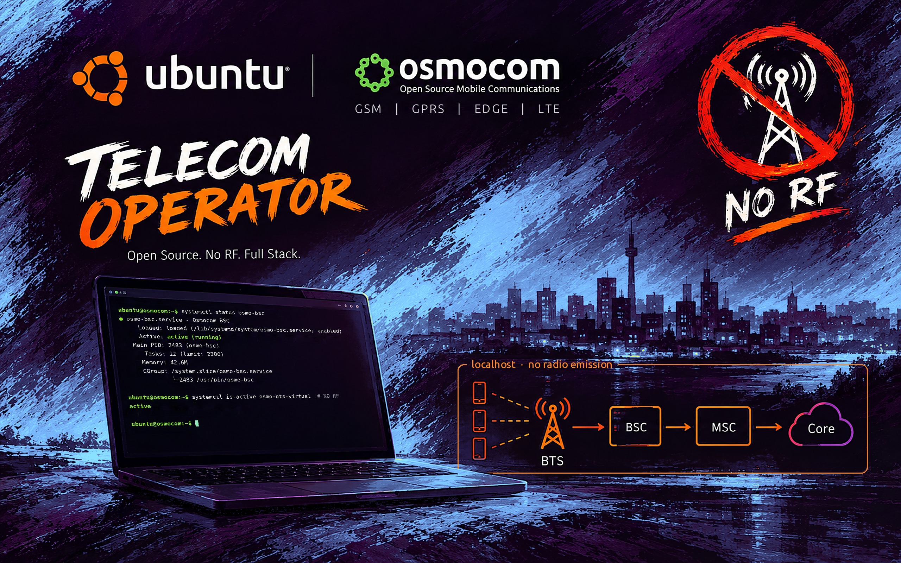

[](https://github.com/bbaranoff/osmo-operator/actions/workflows/build-iso.yml)

## osmo-operator-desktop.iso · v0.2

Live ISO password: **`osmo`** · postmarketOS phone password: **`147147`**

A complete GSM + LTE operator on one image, live or installable, with a GNOME desktop, **without SDR or physical
phone**: the radio is emulated end to end, down to the baseband. Ubuntu 24.04. The starting point: redo Karsten
Nohl's demo (capture GSM, decode it, listen to a call) with no radio at all - phone, network and radio link
emulated on one laptop. Talk: 40C3, « Emulating the baseband ».

### Download

**Download every `.part-NN` file**, not just the first one (GitHub caps release files at 2 GiB). Then:

```sh
cat osmo-operator-desktop.iso.part-* > osmo-operator-desktop.iso
sha256sum -c --ignore-missing SHA256SUMS
```



### At a glance

Nothing telecom starts at boot: starting a network is a deliberate act (icon, `systemctl` or launcher). The full
repository, `.git` included, is in `/opt/GSM/osmo-operator`.

| Layer | What it is |
|---|---|
| Emulated phone | Calypso emulated by [qosmo](https://github.com/bbaranoff/qosmo) (QEMU fork, ARM7); four firmwares: rssi, trx, layer1 (OsmocomBB), Magnetite (original TI) |
| DSP | a C54x running the real TI mask ROM, outside QEMU ([c54x_exe](https://github.com/bbaranoff/c54x_exe)) |
| Radio bridge | `pont.py` / `pont_dsp.py`: bursts <-> osmo-bts-trx over TRXD |
| I/Q spectrum | bursts remodulated in GMSK, DL + UL spectrum, waterfall, cfile replayable by gr-gsm |
| 2G core | full Osmocom stack, Asterisk voice, SMSC, GPRS/EDGE, SS7 with TCAP |
| 4G / CSFB | Open5GS + srsRAN over ZeroMQ, a real SGs interface MME <-> MSC, WebUI on :8999 |
| Smartphone | postmarketOS/Phosh VM, oFono, simulated AT modem |
| Multi-operator | 1 to 9 operators over SS7/IP, inter-STP |
| Non-IP transport | raw GSM-HR voice over LoRa (RNode), WAN between machines |
| GTK interfaces | Constellation, ms-pont, osmo-iso, beacon, terminal-free launchers |
| Tests | `check_all.sh`, TTCN-3 (Eclipse TITAN), pytest |
| Installed system | **two systems on the disk** (root live, nirvana encrypted), **TPM porte**, **black box**, several users |
| Delivery | amd64 ISO, arm64 SD (rpi4, opi5), Docker, native install |

### New in 0.2: the installed machine

Installing (Calamares, « Encrypt system » ticked) puts **two systems** on the disk:

| Partition | Encrypted | Holds |
|---|---|---|
| EFI | no | the first GRUB menu (`osmo-grub-esp`) |
| `osmo-racine` (16 GiB) | no | **root's system**: the ISO image, booted live (RAM) - everything gone at reboot |
| `osmo-diffs` (5 GiB) | no (each record is) | the **black box** |
| `/` (the rest) | LUKS1 | **nirvana's system**: `/`, `/boot`, `/home`, read-write |

- **Root** changes only its own system: editing the GRUB line or its partition never touches what nirvana boots.
  Root has no network identity of nirvana's, and in root sessions SSH refuses passwords.
- **The porte** (when the BIOS has an active TPM 2.0 - fTPM / PTT; installer page « Demarrage »): GRUB asks
  nothing; a small initramfs shows a **6-digit TOTP code computed by the TPM**, which it only computes if firmware,
  shim, GRUB, its menu, the kernel and the porte are exactly those of the sealing. Compare it with your phone (any
  TOTP app doing SHA-256), then type the passphrase: the porte opens the volume and kexecs nirvana's kernel, which is
  inside it. Esc, Enter or 60 s: root, read-only. The key never leaves the TPM and is locked at the decision.
  Setting up after the first boot: `sudo osmo-porte sceller`, then `sudo osmo-porte qr`. Phone lost:
  `sudo osmo-porte nouvelle-cle`. Without a TPM, GRUB asks the passphrase itself (a replaced GRUB is then not
  detected).
- **The black box** (`osmo-diffs`): one record per boot of the TEXT changes of the system (root sessions
  included), written at shutdown, encrypted with `age` for a public key - the machine fills it without being able
  to read it; only its own passphrase does (`sudo osmo-diffs phrase`, `osmo-diffs voir`, or the GRUB entry
  « consulter la boite noire » instead of booting). Records are chained; a truncated end is caught at the next
  nirvana boot; `sudo osmo-diffs copie-poser user@host` sends each record to another machine that only accepts
  additions.
- **Several people**: `sudo osmo-utilisateur ajouter NOM` - a LUKS passphrase of their own, an account without
  sudo, a `/home/NOM` encrypted with fscrypt under their login password.
- **SSH**: no host key in the image any more - each machine, and each system, gets its own.

What this protects, what it does not, and the procedures (updates, TPM failure, lost phone):
[wiki/ISO.md, 6.7](https://github.com/bbaranoff/osmo-operator/blob/main/wiki/ISO.md). **Not yet validated on real
hardware**: test it in a VM first with `tools/osmo-vm-porte.sh` (QEMU, Secure Boot, software TPM).

### Also new in 0.2

- **Ubuntu-style installer**: a light header with the step name and progress dots, Quit / Back / Next at the bottom.
- **osmo-gtk (Constellation)**: the bench in one GTK window pinned to the dock, coloured logs, pytest and TTCN.
- **osmo-ms-pont**: the mobile chain without a phone (DSP, ARM, osmocon, bridge) from a window.
- **osmo-iso** / `./build.sh --gtk`: build an amd64 ISO or an arm64 SD image from a window.
- **osmo-balise**: the mast beacon follows the bench (day wallpaper at rest, evening + red/green beacon running).
- **`--lora`**: voice between two nodes over LoRa (RNode Heltec V3) as raw GSM-HR frames, no IP; push-to-talk
  (`take` / `release`) and record-then-send; channel statistics every 5 s.
- **GSM-HR <-> GSM-FR transcoder** (`--hr`), full rate by default; libosmo-sigtran with TCAP routing.
- **TTCN-3 in the ISO**: Osmocom suites with Eclipse TITAN against the bench binaries, pcaps and logs, « NOT RUN »
  instead of a fake 0/0. pytest and bash-completion installed; numpy 1 for GNU Radio and gr-gsm.
- **Open5GS WebUI** built into the ISO, port 8999, no restart loop.
- Core isolation and multithreading by default (`start.sh`); `INSNS=auto` sizes the DSP budget to the CPU.
- osmo-bts-trx 1.12+ compatible (no more « TRX clock skew too high »).
- Terminal: a random telecom banner; prompt with a green off-hook phone for root, a red on-hook one for the others.
- FreeCalypso only from the official sources, through a SHA-256-checked cache; `verif_rom.sh` proves DSP ROM 3606.
- Sober GRUB theme: the handset on the left, the BTS on the right.

### What's inside

**The emulated phone - qosmo.** QEMU machine `-M calypso` (UART, TPU/TSP, keypad, screen, ARM <-> DSP mailbox).
Four images on the same emulator: `rssi` and `trx` (DSP, TPU/TSP, burst timing), `layer1` (OsmocomBB layer 1
driven by `mobile` over L1CTL), and **Magnetite**, the original TI firmware rebuilt by FreeCalypso, on an emulated
C123 (`--ms-magnetite`). It scans, camps, registers, authenticates, ciphers (A5), sends SMS and makes MO/MT calls.
Layer1 firmware for 10 compal boards, 7 DSP ROMs; gdb on `:1234`; screens and keypads with `c123 --instance N`;
« over the air » mode (`--bts --ms --ts N`): one Calypso is the BTS radio, a second one camps on it.

**The DSP.** `c54x_exe` runs the real TMS320C54x mask ROM outside QEMU. Layer 1 on the **DSP** (default) or
**gr-gsm** (`--grgsm`).

**The radio bridge.** `pont.py` / `pont_dsp.py` connect the emulated layer 1 to osmo-bts-trx over **TRXD**
(5700-5702). The bench carries **bursts**, not a continuous I/Q stream - about 250 times less data, so any PHY will
do (LoRa, WAN...).

**The I/Q spectrum (no RF).** Bursts remodulated in GMSK; blue = downlink, orange = uplink; per-timeslot gr-gsm bar
on the desktop; **osmo-egprs-web** on `:8080` (capture, FFT, waterfall MS vs BTS, VTY, audio, tshark). A `cfile`
(cf32, 1.0833 MHz) replays offline with `grgsm_decode`, independently of the bench.

**2G core - Osmocom.** osmo-stp (M3UA, SCTP :2905), osmo-bsc, osmo-msc, osmo-hlr, osmo-sgsn, osmo-ggsn, osmo-pcu,
osmo-mgw, osmo-bts-trx. PLMN 001-01, two DCS1800 cells in LAC 1 (BSIC 7 and 8), test subscribers, A5/1,
deterministic RAND (reproducible runs). **Voice**: osmo-sip-connector -> Asterisk (SIP :5060), Linphone extension
**100**. **SMS**: SMS-over-GSUP, SMPP (:2775), inter-operator relay (:7890). **Data**: GPRS/EDGE (`APN=internet` in
`globals.conf`). `osmo-msc.cfg` with **SGs** (CSFB). Remote SIM (SAP) only with `--sap` / `--softsim`. GSMTAP on
:4729 for Wireshark.

**4G - Open5GS + srsRAN.** MME, SGW-C/U, SMF, UPF, PCRF, HSS; MongoDB behind the HSS; freeDiameter TLS (S6a, Gx).
srsENB / srsUE over **ZeroMQ** (no SDR), portable binaries, srsGUI. Null NAS ciphering on purpose (readable in
Wireshark). **CSFB** over a real SGs interface, 3GPP-compliant 4G -> 2G voice fallback. 4G does not depend on 2G.

**The smartphone - postmarketOS.** Phosh VM under QEMU, oFono on a virtual modem (`osmo-phonesim-banc.py`). Data on
4G (pppd), voice and SMS on 2G. Embedded VM image, `pmaports` pinned (no clone on first click). **Start it last.**

**Multi-operator SS7.** 1 to 9 operators in containers, joined by a central M3UA/SCCP **inter-STP**; point codes,
routing contexts, SIP trunks, dialplan and SMS routing generated for N; `addition.sh --multi`.

### Launchers and options

| Command | Effect |
|---|---|
| `start.sh --bts-classique --ms` | default: osmo-bts-trx <-> bridge, phone on the DSP ROM |
| `start.sh --ms-magnetite` | phone on the TI Magnetite firmware |
| `start.sh --bts --ms --ts N` | the Calypso as the BTS radio, a second one camps on it |
| `start.sh --grgsm` | gr-gsm as layer 1 |
| `banc-rssi` | RSSI measurement bench |
| `--lora` / `--hr` / `--sap`, `--softsim` | voice over LoRa / HR <-> FR transcoding / remote SIM |
| `start.sh --stop` | stop everything |
| `osmo-lte` / `osmo-epc` | eNodeB / Open5GS core |
| `osmo-pmos` | smartphone VM |

Diagnostics: `checks/check_all.sh` (`--only=...`, `--verbose`), `checks/diag-stp-operator.sh`, `ss7-console.py`.
TTCN-3: `sudo /opt/GSM/osmo-operator/scripts/ttcn.sh run hlr`.

### Running the image

x86_64, **8 GB of RAM and 4 cores** minimum; in a VM, enable nested virtualization. Installing: **55 GB** of disk.

```sh
qemu-system-x86_64 -cdrom osmo-operator-desktop.iso -m 8G -enable-kvm \
  -cpu host -smp 4 -nic user,hostfwd=tcp::8080-:8080
```

VirtualBox or VMware: Linux / Ubuntu 64-bit, 8 GB, 4 CPUs, nested VT-x/AMD-V ticked, the ISO in the optical drive.
USB stick: `sudo dd if=osmo-operator-desktop.iso of=/dev/sdX bs=4M status=progress conv=fsync` (Rufus: DD mode).

### Getting started

1. Boot the ISO (live), or install it with the **Installer** icon (tick « Encrypt system »).
2. The live session opens on `root` (`osmo`; `osmocom` / `osmo` after logout - lab defaults, change them on any
   exposed machine).
3. Start the bench from the dock:

| Dock | Starts |
|---|---|
| **?** | the help: every mode, module, notebook and repository |
| red phone | the 2G bench, `./start.sh --bts-classique --ms` |
| signal bars | 4G: Open5GS, srsENB, srsUE and SGs |
| phone | the postmarketOS VM (start it last) |

4G admin console (Open5GS WebUI): http://localhost:8999. Other modes: `cd /opt/GSM/osmo-operator && sudo ./start.sh --help`.

**Supplements** (`sudo addition.sh` or the dock icon, not in the ISO): `--multi` (Docker + SS7 multi-operator),
`--opencl` (A5 tools: deka, a51_tools), `--claude` (Claude Code), `--extras` (gnuarm toolchain, Wine + TMS470 for
Magnetite, TRX firmware, Fernvale, SIMCom SDK).

### Useful paths

| What | Where |
|---|---|
| Bench repository | `/opt/GSM/osmo-operator` |
| srsRAN configs | `/root/.config/srsran` |
| Open5GS configs | `/opt/LTE/open5gs/install/etc/open5gs` (freeDiameter, `tls/`) |
| Smartphone UI | `/opt/user_interface/pmos` |
| Beacon wallpapers | `/usr/share/backgrounds/osmo-balise` |
| Black box | `/var/lib/osmo-diffs` (installed machine) |

Build packages (srsenb, Open5GS, pmOS PPP kernel, pmbootstrap) are also published outside the ISO:
https://github.com/bbaranoff/osmo-operator/releases/download/debs-banc

### Known limits

- The two-system install, the TPM porte and the black box are new and **not yet validated on real hardware**.
- Magnetite: calls need A5/0. `--bts --ts 2`: camps and registers, no call yet; `--ts 2/1` calls.
- The ROM vocoder costs real time on slow hosts: use `--gapk`. Do not compile while a bench runs.

Documentation: [README](https://github.com/bbaranoff/osmo-operator#readme) ·
[wiki](https://github.com/bbaranoff/osmo-operator/blob/main/wiki/Home.md) ·
[bbaranoff.github.io](https://bbaranoff.github.io) · [pl4y.store](https://pl4y.store).
