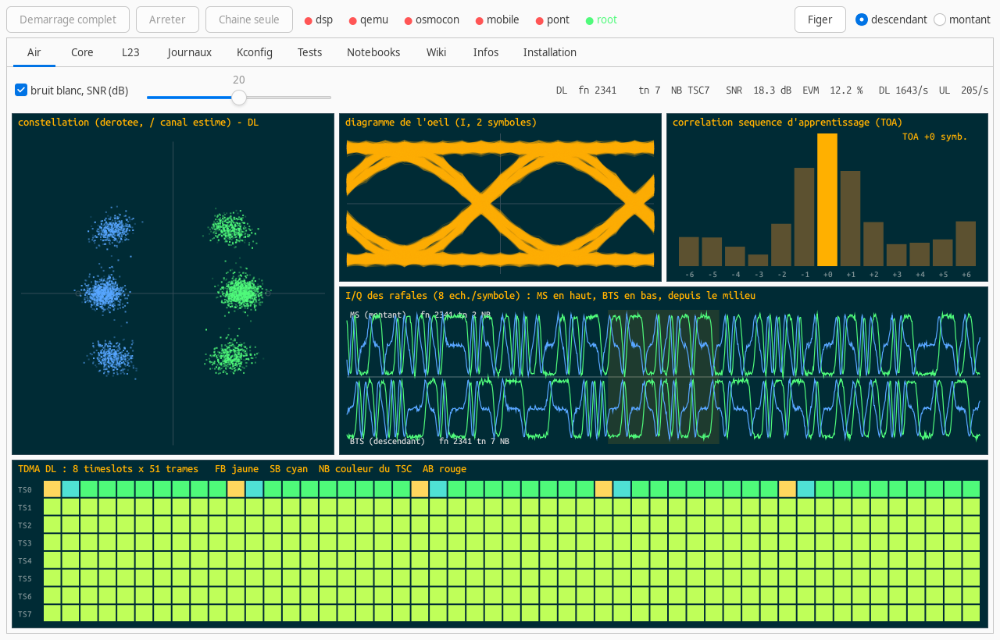
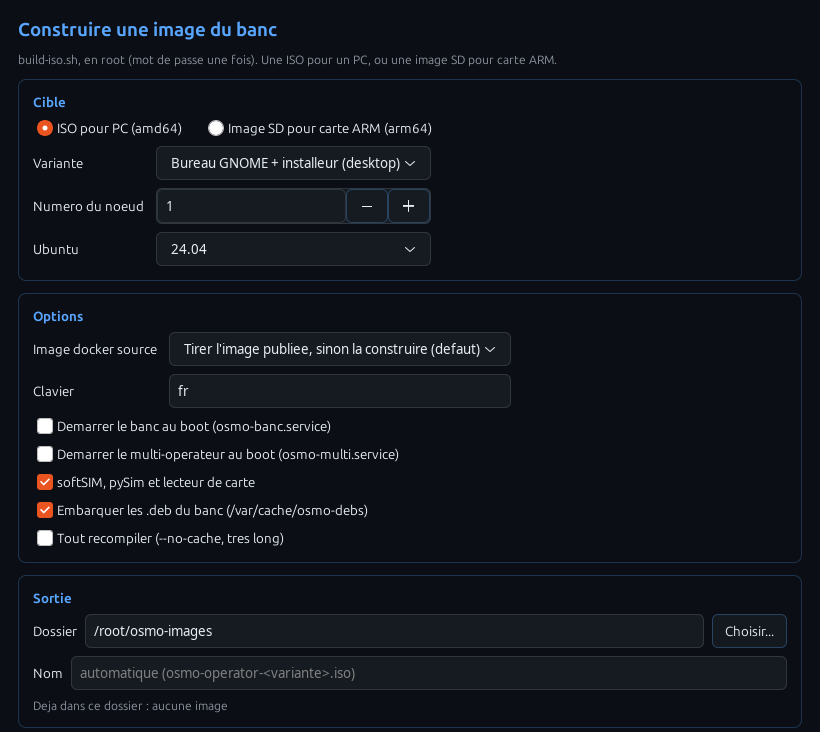

# osmo-operator

> **40C3:** this repository is part of the talk *Emulating the Baseband* (40th Chaos Communication Congress, Hamburg). Fahrplan link to come.

A complete **GSM + LTE operator on one machine**: an Osmocom core network (BTS, BSC, MSC, HLR, MGW, SMSC,
Asterisk) and **emulated Calypso phones**. The ARM runs under QEMU ([qosmo](https://github.com/bbaranoff/qosmo)) and the
TI C54x DSP runs outside it, executing the real mask ROM ([c54x_exe](https://github.com/bbaranoff/c54x_exe)). The phone
is either the OsmocomBB `layer1` + `mobile`, or a Motorola C139 running the **original TI firmware** (FreeCalypso
Magnetite). It camps, authenticates, ciphers, sends SMS and holds voice calls. No SDR and no physical phone: the
radio is emulated end to end, down to the baseband.


**Latest release: [v0.2](https://github.com/bbaranoff/osmo-operator/releases/tag/v0.2)**: live/installable amd64 ISO,
arm64 SD images (Raspberry Pi 4, Orange Pi 5 family), Docker image. Illustrated guide to the ISO:
[osmo-operator - ISO 0.2 on RPubs](https://rpubs.com/bbaranoff/iso-latest). What changed: [New in v0.2](#new-in-v02).

## Start here

| I want to… | Read |
|---|---|
| Boot a ready-made live image (fastest, nothing to build) | [iso](doc/README-iso.md) · [latest release](https://github.com/bbaranoff/osmo-operator/releases/latest) · [illustrated guide (RPubs)](https://rpubs.com/bbaranoff/iso-latest) |
| Pick a mode and run it | [Modes](#modes) below · the **?** of the dock (`osmo-info`) · [lancer-les-modes.ipynb](wiki/lancer-les-modes.ipynb) |
| Install on Ubuntu 24.04 without Docker | [native](doc/README-native.md) · [installer-osmo-jusquau-dsp.ipynb](wiki/installer-osmo-jusquau-dsp.ipynb) |
| Run in Docker, or build the images | [docker](doc/README-docker.md) · `docker pull bastienbaranoff/norf_gsm` (amd64) |
| Run on a Raspberry Pi 4 / Orange Pi 5 (arm64 SD images, 2G only) | [arm](doc/README-arm.md) · [latest release](https://github.com/bbaranoff/osmo-operator/releases/latest) |
| Study the real C54x DSP on the mask ROM | [dsp](doc/README-dsp.md) |
| Run the original TI firmware (C139, Magnetite) | [magnetite](doc/magnetite.md) |
| Use the gr-gsm layer 1 | [grgsm](doc/README-grgsm.md) |
| Add 4G, CSFB and the postmarketOS phone (amd64 only) | [lte](doc/README-lte.md) |
| Several operators, SS7 interconnect, a WAN between machines | [ss7](doc/README-ss7.md) · [WAN](wiki/WAN.md) |
| Drive the bench day to day: tmux, VTY, ports, Wireshark | [usage](doc/README-usage.md) |
| Check that the bench is healthy, reproduce a fault | [tests](doc/README-tests.md) |
| See how the pieces fit | [architecture](doc/README-architecture.md) · [all documents](doc/README-docs.md) |

## Modes

Everything goes through `./start.sh` (`start-native.sh` is a symlink to it). `--regen` rebuilds
`/etc/osmocom` from the templates, `--no-attach` stays out of tmux, `./start.sh --docker` hands over to
`launch/start-docker.sh`, `./start.sh --help` lists every option.

| Command | What runs | State |
|---|---|---|
| `./start.sh --bts-classique --ms` | **Default** (red phone icon). `osmo-bts-trx` ↔ `pont/pont_dsp.py`; the phone runs osmocom-bb `layer1` + `mobile` on the DSP ROM | LU, SMS, calls |
| `./start.sh --bts-classique --ms-magnetite` | Same network, the phone is a C139 running the TI firmware; `--gapk` for voice on the host | LU, SMS; calls in A5/0 (`ENCRYPTION="a5 0" ./start.sh --regen …`) |
| `./start.sh --bts --ms --ts 2` | The Calypso of QEMU **is the BTS radio** (`trx` firmware + `transceiver`); a second Calypso camps on it over the air; one Calypso per timeslot | camps, LU; no call (see Known issues) |
| `./start.sh --bts --ms --ts 2/1` | TS0 + TS1 on one Calypso TRX (default of `--bts`) | calls |
| `./start.sh --grgsm` | gr-gsm layer 1 instead of the DSP | end to end |
| `banc-rssi` | The osmocom-bb `rssi` app on a 4th Calypso, fed by the bridge; screen `c123-3` | DL levels, sync, BCCH |
| `./start.sh --stop` | Stop the whole stack | |

Phone screens and keypads (`scripts/osmo-banc-aliases.sh`): `c123` = instance 1 (phone of `--bts-classique`, or
TRX of `--bts`), `c123-1` = instance 2 (phone over the air), `c123-2` = instance 3 (second TRX), `c123-3` =
instance 4 (rssi), `c123-mobile` = the first live instance that is not a TRX, `c123-tous` = all of them. The
underlying command is `tools/osmo-c123-gtk.py --instance N`. Nothing telecom starts at boot
([`services/80-osmo-operator.preset`](services/80-osmo-operator.preset)): starting a network is your gesture.

Quickest path from the ISO (password `osmo`):

```bash
cat osmo-operator-desktop.iso.part-* > osmo-operator-desktop.iso
sha256sum -c --ignore-missing SHA256SUMS
qemu-system-x86_64 -cdrom osmo-operator-desktop.iso -m 8G -enable-kvm -cpu host -smp 4
```

From a clone (native, or inside the container):

```bash
./start.sh --regen --bts-classique --ms   # first run: generate the configs, start, attach to tmux
./start.sh --stop
```

## Notebooks

| Notebook | What it does |
|---|---|
| [installer-osmo-jusquau-dsp.ipynb](wiki/installer-osmo-jusquau-dsp.ipynb) ([nbviewer](https://nbviewer.org/github/bbaranoff/osmo-operator/blob/main/wiki/installer-osmo-jusquau-dsp.ipynb)) | Fresh Ubuntu 24.04 to a call on the DSP, one cell per step with checks; optional Magnetite build |
| [lancer-les-modes.ipynb](wiki/lancer-les-modes.ipynb) ([nbviewer](https://nbviewer.org/github/bbaranoff/osmo-operator/blob/main/wiki/lancer-les-modes.ipynb)) | Each mode above: start, check, stop; the phone screens inline, keys, `banc-rssi` |
| [lancer-pas-a-pas.ipynb](wiki/lancer-pas-a-pas.ipynb) ([nbviewer](https://nbviewer.org/github/bbaranoff/osmo-operator/blob/main/wiki/lancer-pas-a-pas.ipynb)) | The bench process by process: HLR, MGW, MSC, BSC, BTS, QEMU, osmocon, mobile, bridge |

How to run them (disposable container, VM, unattended `nbconvert`): [README-notebook](wiki/README-notebook.md).

## Supplements

What is not in the ISO installs with `sudo ./addition.sh` (a checklist window, or flags):

| Flag | Installs |
|---|---|
| `--multi` | Docker, the operator image, the SS7 multi-operator topology |
| `--opencl` · `--claude` · `--extras` · `--sim` | GPU OpenCL and A5 tools · Claude Code · games and media · PC/SC SIM tools |
| `--gnuarm` | the historic OsmocomBB toolchain, arm-elf-gcc 4.5.2 (`/opt/additions/gnuarm`, added to `PATH` by `/etc/profile.d/97-osmo-gnuarm.sh`) |
| `--magnetite` | Wine + TI TMS470, FreeCalypso Magnetite for the C139, the bench patches, the flash image |
| `--trx` | [osmocom-bb-trx](https://github.com/bbaranoff/osmocom-bb-trx): the Docker image and the `trx` firmware (TX) built with gnuarm |
| `--calypso-fw` | the bench's Calypso firmware (`layer1`, `rssi`) rebuilt with gnuarm (prebuilt in [firmware](https://github.com/bbaranoff/firmware)) |
| `--fernvale` | MediaTek MT6260: [fernly](https://github.com/bbaranoff/fernly), [fernvale-nuttx](https://github.com/bbaranoff/fernvale-nuttx), [osmocom-bb-mtk-layer1](https://github.com/bbaranoff/osmocom-bb-mtk-layer1) |
| `--simcom` | the [SIMCom](https://github.com/bbaranoff/simcom) documentation and SDKs |
| `--firmwares` | all the firmware supplements above |
| `--all` | Docker, image, multi, OpenCL, Claude, extras, SIM |
| `--status` | show what is installed, install nothing |

## New in v0.2

- **The installed machine** (the « secured bench », TPM 2.0 required): Calamares encrypts `/home` only (LUKS2);
  `/` is in clear and read-only, and the system runs in RAM. Nothing reaches the disk without the `/home`
  passphrase, and what reaches it is recorded and can be undone.
  - **Two openings**: with the passphrase, « Persistant ? » - yes: `/home` is written straight to the encrypted
    volume; no: it stays under a RAM layer and is written only when saved. Without the passphrase: a guest root,
    all in RAM, nothing kept.
  - **At shutdown** the passphrase writes what changed in the system, atomically. In persistent mode forgetting
    is a voluntary gesture: the « Remettre à zéro » icon puts `/home` back as it was at boot.
  - **Black box** (`osmo-diffs`, `osmo-boite`): every session recorded, encrypted with `age` for a key the machine
    does not hold, chained; its end is held by a TPM extend-only index, so a truncation shows.
  - **Integrity**: a fingerprint of the disk signed with a key only the passphrase unlocks, anchored in the TPM;
    a measured boot (the initramfs reads the disk's very content) that gives its proof only on the untouched
    machine: a PIN, then a code to compare with your phone (two factors), or a secret sentence behind the PIN.
  - **The states of the system, like code**: every validated write is a commit, kept in `/home`, chained and
    signed; `osmo-etats` browses them like GitHub (commits, diffs, the tree at each state).
  - **The alarm**: checksums clean at boot and different at shutdown = red screen, beep at full volume, and the
    machine refuses to go off. Any integrity alert: no guest root, only the owner goes on. A test button trips it
    for real on a witness volume (partial, or full).
  - **SSH**: a host key per machine.

  Everything - design, the perimeter table (who can read and modify what), and what was actually run on a real
  machine versus only in a sandbox: [wiki/Poste-securise.md](wiki/Poste-securise.md). Installation by the ISO
  with the whole set is not tested yet. Not a barrier against a root in an open session: it makes sure that
  leaves traces root cannot erase cleanly.
- **Constellation** (`osmo-gtk`): the bench in one GTK window. It shows the constellation, eye diagram,
  training-sequence correlation, burst I/Q and TDMA grid, with tabs for the core, L23, logs, Kconfig, tests,
  notebooks and installation.
- **osmo-ms-pont**: the mobile chain without a phone (DSP, ARM, osmocon, bridge), from a window.
- **osmo-iso** (`./build.sh --gtk`): build an amd64 ISO or an arm64 SD image from a form.
- **osmo-balise**: the mast beacon follows the bench (day wallpaper at rest; evening and a red/green beacon while
  it runs).
- **`--lora`**: voice between two nodes over LoRa (RNode Heltec V3) as raw GSM-HR frames, no IP.
- **GSM-HR <-> GSM-FR transcoder** (`--hr`); libosmo-sigtran with TCAP routing; TTCN-3 suites (Eclipse TITAN) in
  the ISO.
- **arm64 SD images** built by the official armbian/build framework, one per board: Raspberry Pi 4 and Orange Pi 5,
  5B, 5 Plus, 5 Pro, 5 Max, 5 Ultra. They carry 2G/EDGE in full, but no 4G.
- **CI**: the ISO starts from the GHCR base image of its own commit when one is published. Otherwise it falls
  back to Docker Hub, with a warning, or compiles.

| Constellation: the air of the bench | osmo-iso: build an image from a window |
|---|---|
|  |  |

## Repository layout

| Path | Purpose |
|---|---|
| `start.sh`, `start-native.sh` (symlink) | the launcher: loads the environment, picks the mode, generates `mobile_*.cfg`, then runs `/opt/GSM/qosmo/run.sh`; `--docker` hands over to `launch/start-docker.sh` |
| `startup_scripts/` | the launcher's steps, sourced in order by `start.sh` (options, node identity, environment, DSP bench menu, mobile plan, config regeneration, start) |
| `launch/` | the other launchers: `start-docker.sh` (containers, N operators), `start-interstp.sh` (the SS7 hub node), `start-multi.sh` (native + Docker operators), `start-nitb.sh`, `start-oqc.sh`, `osmo-launch.sh` |
| `environment/` | `load.env`, `paths.env`, `modes.env`: variable precedence and path resolution ([README](environment/README.md)) |
| `globals.conf`, `globals.conf.example`, `generate_configs.sh` | the network settings (ARFCN, PLMN, …) and the only script that substitutes them into the templates |
| `configs/` | configuration templates for every daemon (`osmo-*.cfg`, Asterisk, open5gs, `gprs/`, `conky/`), wallpapers and screenshots |
| `lib/` | `gabarits.sh` (template substitution), `audio.sh` (PulseAudio + GAPK chain) |
| `pont/` | the radio bridges between the emulated Calypso and `osmo-bts-trx`: `pont.py` (gr-gsm), `pont_dsp.py` (DSP), `air.py`/`airmesh.py` (over-the-air between Calypsos), `dsp/` ([README](pont/README.md)) |
| `scripts/` | run-time services and diagnostics: SMS relay (`sms-interop-relay.py`), audio (`gapk-start.sh`, `audio-diag.sh`), `call-diag.sh`, `banc-repro.sh`, `egprs-dsp.sh`, `magnetite-c139.sh`, the bench aliases, the Docker entrypoint and in-container `run.sh` |
| `checks/` | read-only health checks of a running stack (`check_all.sh`, `ss7_check.sh`, `diag-*.sh`, `annuaire.sh`) |
| `network/` | WAN table, mesh, firewall, VirtualBox interconnect, ISM payload, LoRa link (`setup-lora-link.sh`) and payload switch (`setup-lora-payload.sh`), IP plan, loopbacks |
| `navigation/`, `ss7-console.py` | the SS7 console (MAP/TCAP/SCCP/M3UA, TUI, diagnostics); `ss7-console.py` at the root is a shortcut ([QUICKSTART](navigation/QUICKSTART.md)) |
| `helpers/`, `set_stp_ip.sh` | inter-STP config generator, host preparation, SS7 addressing of a VM |
| `tools/` | user tools: phone screens (`osmo-c123-gtk.py`), FFT viewers, `osmo-info`, `osmo-launcher.py`, settings page (`osmo-reglages.py`), LTE/pmOS/SIM installers, `osmo-patches-apply.sh`, `osmo-firmwares-install.sh`, documentation generators (`full_qmd.sh`, `full_text.sh`, `dockerfile-to-install-md.sh`) |
| `patches/` | patches applied on top of the upstream trees under `/opt/GSM` by `tools/osmo-patches-apply.sh` (idempotent; used by `install_modules/40-patches.sh`, `iso_modules/70-scripts.sh`, `update.sh` and `addition.sh --calypso-fw`) |
| `install.sh`, `install_modules/` | native installation by steps (`prereqs`, `deps`, `user`, `sources`, `patches`, `build`, `binaires`, `configs`, `bureau`, `verify`) |
| `addition.sh`, `tools/osmo-*-install.sh` | the supplements above |
| `update.sh` | ISO session start: login animation and patch catch-up on an installed machine |
| `Dockerfile`, `Dockerfile.lite`, `Dockerfile.run`, `Dockerfile.stp`, `build.sh`, `compose.sh`, `compose.yaml` | the Docker images and Compose topology ([README-docker](doc/README-docker.md)) |
| `packaging/` | the `.deb` cache (`osmo-deb.sh`), standalone packages (`build-debs.sh`), apt mirror helpers |
| `build-iso.sh`, `iso_modules/`, `installer/` | the live ISO, the SD image and the Calamares installer ([README-iso](doc/README-iso.md), [wiki/ISO](wiki/ISO.md)) |
| `armbian/` | the same arm64 image through the official armbian/build framework ([README-arm](doc/README-arm.md)) |
| `services/` | shipped systemd units and the boot preset ([README](services/README.md)) |
| `data/` | desktop entries, icons, phone photos and click zones (`c123*`, `c139*`), node/operator name tables |
| `instances/` | per-Calypso-instance settings (`instance-N.env`, written by the settings page) |
| `web/`, `fft-web/` | the settings web page and the two-spectrum FFT web server (port 8081) |
| `doc/` | topic READMEs, `magnetite.md`, step-by-step install guides, screenshots (`doc/images/`) |
| `wiki/` | the wiki pages and the notebooks |
| `tout-en-un.py` | gathers the text files of a tree into one shortened Markdown report |

## Wiki

| Page | Contents |
|---|---|
| [Home](wiki/Home.md) | quick start, launching, reference card |
| [Start-native](wiki/Start-native.md) | the launcher step by step, option manual |
| [Reference](wiki/Reference.md) | architecture, layer-1 chains, build graph, multi-PLMN SS7, diagnostics |
| [Build](wiki/Build.md) · [ISO](wiki/ISO.md) | `build.sh`, `build-iso.sh`, `.deb`, `install.sh`; what the ISO contains |
| [Environnement](wiki/Environnement.md) | which variables win, what reaches QEMU |
| [Resultats](wiki/Resultats.md) | reference `check_all.sh` runs and how to read the deviations |
| [Telephone-emule](wiki/Telephone-emule.md) | plug **only** the emulated phone into your own Osmocom stack |
| [Lancer-a-la-main](wiki/Lancer-a-la-main.md) | the phone started by hand, with proof at each step |
| [Installer-qosmo](wiki/Installer-qosmo.md) · [Installer-c54x_exe](wiki/Installer-c54x_exe.md) · [Installer-grgsm_exe](wiki/Installer-grgsm_exe.md) | building the QEMU fork and the two external layer 1s |
| [SIM](wiki/SIM.md) | a sysmoISIM in an Omnikey reader, or a softSIM, over SAP |
| [WAN](wiki/WAN.md) · [Payload-ISM](wiki/Payload-ISM.md) · [LoRa](wiki/LoRa.md) | linking nodes; SMS text over an ISM radio link; call and SMS payload over a LoRa link (RNode / Heltec V3) |

## Other documents

| Document | Subject |
|---|---|
| [`pont/README.md`](pont/README.md) | the radio bridge: A5 ciphering, Kc and SACCH |
| [`doc/magnetite.md`](doc/magnetite.md) | the TI firmware in qosmo: build, flash image, running, debugging |
| [`environment/README.md`](environment/README.md) | environment variables and path resolution |
| [`services/README.md`](services/README.md) | the systemd units shipped, and the boot policy |
| [`navigation/QUICKSTART.md`](navigation/QUICKSTART.md) | the SS7 console |
| [Components and their READMEs](doc/README-docs.md#components-and-their-readmes) | every Osmocom module and third-party component, with the local patches |

## Repositories and sites

| | |
|---|---|
| [qosmo](https://github.com/bbaranoff/qosmo) · [c54x_exe](https://github.com/bbaranoff/c54x_exe) · [grgsm_exe](https://github.com/bbaranoff/grgsm_exe) | the QEMU fork and the two external layer 1s |
| [firmware](https://github.com/bbaranoff/firmware) · [osmocom-bb-trx](https://github.com/bbaranoff/osmocom-bb-trx) | prebuilt Calypso firmware; osmocom-bb jolly/testing with TX |
| [osmo-egprs-web](https://github.com/bbaranoff/osmo-egprs-web) | the dashboard (http://127.0.0.1:8080) |
| [bbaranoff.github.io](https://bbaranoff.github.io) · [pl4y.store](https://pl4y.store) · [github.com/bbaranoff](https://github.com/bbaranoff) | the author's resources and projects |
| Upstream | [Osmocom](https://gitea.osmocom.org/) · [FreeCalypso](https://www.freecalypso.org/) · [Open5GS](https://open5gs.org/) · [srsRAN](https://www.srsran.com/) |

**Provenance of the DSP ROM.** The TI mask ROM 3606 is the dump published by FreeCalypso
(<https://www.freecalypso.org/pub/GSM/Calypso/dsp-rom-3606-dump.txt>, SHA-256 `e35798f5…`).
The bench downloads it from freecalypso.org only, once, into `.cache/freecalypso/` (never versioned,
SHA-256 checked by `tools/freecalypso-fetch.sh`). A revision-pinned gist mirrors the same file. `./verif_rom.sh` proves it:
it downloads the original from freecalypso.org and every mirror, prints SHA-256 and SHA-512,
compares each copy byte for byte (`cmp`) and gives a verdict (`--local FILE` checks a copy
of your own, exit code 0 when everything is identical).

## Known issues

- `--bts --ms --ts 2` (one Calypso per timeslot): the second TRX phone's frame number is not aligned, so the
  TCH is unusable and calls fail (ASSIGNMENT FAILURE). Use `--ts 2/1` for calls.
- Magnetite calls only work with ciphering off (`ENCRYPTION="a5 0"`).
- 4G, CSFB and the postmarketOS phone are amd64 only.

## Building the ISO from a secured bench (with the TPM protection on)

This is only for those who build **on a machine installed with the secured bench** - the TPM protection of
[wiki/Poste-securise.md](wiki/Poste-securise.md). On an ordinary machine `./build-iso.sh` needs nothing special.

On a secured bench the system runs in RAM: `/`, `/var/tmp`, Docker's storage and this repository
(`/opt/GSM/osmo-operator`) are memory of a few gigabytes over a read-only disk. The build pulls a base image of about
15 GB, writes about 18 GB of work files and an ISO of several gigabytes: left to its defaults it fills the memory and
fails, and whatever it did write is gone at the next boot. Send all three to `/home`, which is the encrypted disk -
and build the **desktop** ISO, the only one that carries the installer (Calamares) and so the secured bench:

```
OSMO_DOCKER_STORAGE_DIR=/home/<you>/docker-data OSMO_ISO_WORK=/home/<you>/iso-build \
    ./build-iso.sh --desktop --output=/home/<you>/osmo-operator-desktop.iso
```

- **`OSMO_DOCKER_STORAGE_DIR`**: where Docker keeps its images (default here: a tmpfs of half the RAM, made at
  boot). The build moves Docker there - no container must be running - and leaves the RAM storage.
- **`OSMO_ISO_WORK`**: where the work files go (default `/var/tmp`, in RAM here).
- **`--output`**: where the ISO goes (default: this repository, in RAM here; a full path is accepted).
- **The base image comes from GitHub** (GHCR: the image of the commit's fingerprint, then `:latest`). Docker Hub is
  no longer tried by default; `OSMO_ISO_PULL_IMAGE=bastienbaranoff/norf_gsm:latest` puts it back first.
- **The postmarketOS VM image** (~2 GB) is embedded in the desktop ISO only: `--no-pmos` leaves it out, `--pmos`
  adds it to another variant. Our Alpine package (network_monitoring, the latest GitHub release) is injected in
  every case and installed in the VM at its first start.
- **Open `/home` as « Persistant »** at boot (the default answer): what the build writes is then on the disk at
  once and survives a reboot. In the other mode (« à enregistrer ») `/home` is a RAM layer too, and the build does
  not fit.
- **« Remettre à zéro » is lost for that session.** In persistent mode the bench keeps, in memory, the old content
  of every block of `/home` the session overwrites - that is what lets it put `/home` back as it was at boot - up to
  a quarter of the RAM (`CRYPTHOME_RESET_MO`). A build overflows that at once: the snapshot is dropped, its memory is
  given back, and the icon answers « plus possible » until the next boot. Nothing else changes: `/home` keeps
  working and the build is not disturbed.
- **A swap for the build, made by itself.** The bench has no swap: when the memory is full the machine dies, with no
  shutdown and nothing written. `build-iso.sh` puts a swap file in `/home` (or next to `OSMO_ISO_WORK` when that is
  on a disk) for the time of the build, the size of the RAM, encrypted with a random key that only the kernel holds:
  unreadable once the build ends or the power goes. Removed at the end; one left by a build that died is removed
  at the next. `OSMO_ISO_SWAP_GB=N` for another size, `0` for none; `OSMO_ISO_SWAP_DIR` for another place.
- **A reboot kills a running build.** It does not resume: every run makes its own work directory. The old one stays
  in `/home` and takes room until it is removed (`sudo rm -rf /home/<you>/iso-build`). Docker's storage in
  `/home` stays too: at the next boot Docker is back in RAM; the next build moves it to the same directory again and
  finds the image already pulled. After the reboot a new
  snapshot is taken, so « Remettre à zéro » works again - for what happens from then on; what the build left in
  `/home` is part of the starting point.
- **Push before you build.** The repository is in RAM: a commit that is not pushed, on a session that is not saved
  with the `/home` passphrase at shutdown, is lost.

---

*osmo-operator is a teaching and research GSM bench: a full core network and emulated Calypso phones on one
machine, down to the DSP mask ROM, with multi-operator SS7 interconnect when you want it.*
