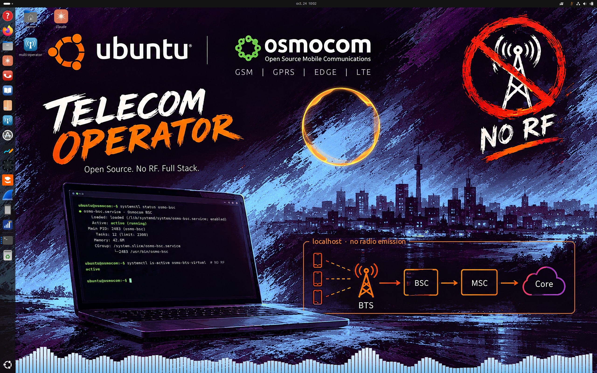

# osmo-operator

[](https://github.com/bbaranoff/osmo-operator/actions/workflows/build-iso.yml)

A complete **GSM + LTE operator on one machine**: an Osmocom core network (BTS,
BSC, MSC, HLR, MGW, SMSC, Asterisk) and an **emulated Calypso handset** that
runs the real OsmocomBB `layer1` firmware. The handset camps, authenticates,
ciphers, sends SMS and holds voice calls. No SDR and no physical phone are
needed: the radio is emulated end to end, down to the baseband.



## Start here

| I want to… | Read |
|---|---|
| Boot a ready-made live image (fastest path, nothing to build) | [iso](doc/README-iso.md) |
| Run the bench in Docker, or build the images | [docker](doc/README-docker.md) |
| Install and run on Ubuntu 24.04 without Docker | [native](doc/README-native.md) |
| Run on a Raspberry Pi 4 / arm64 | [arm](doc/README-arm.md) |
| Use the gr-gsm layer 1 (the chain that works end to end) | [grgsm](doc/README-grgsm.md) |
| Study the real TI C54x DSP on the mask ROM (`--dsp`) | [dsp](doc/README-dsp.md) |
| Add 4G, CSFB and the postmarketOS phone | [4G lte](doc/README-lte.md) |
| Run several operators, SS7 interconnect, link machines over a WAN | [ss7](doc/README-ss7.md) |
| Drive the bench day to day: tmux, VTY, ports, Wireshark, call flows | [usage](doc/README-usage.md) |
| Check that the bench is healthy, reproduce a fault | [tests](doc/README-tests.md) |
| Understand how the pieces fit (diagrams, call flows, code map) | [architecture](doc/README-architecture.md) |
| See every document and where to start | [docs](doc/README-docs.md) |

Quickest path, from the ISO (password `osmo`):

```bash
cat osmo-operator-desktop.iso.part-* > osmo-operator-desktop.iso
sha256sum -c --ignore-missing SHA256SUMS
qemu-system-x86_64 -cdrom osmo-operator-desktop.iso -m 8G -enable-kvm -cpu host -smp 4
```

Quickest path, from a clone (native or inside the container):

```bash
./start-direct.sh --regen     # first run: generate configs from the templates
./start-direct.sh             # start the bench, attaches to tmux
./start-direct.sh --stop
```

## Wiki

The wiki is the detailed reference. The topic READMEs above are entry points
into it.

| Page | Contents |
|---|---|
| [Home](wiki/Home.md) | quick start, launching, reference card |
| [Reference](wiki/Reference.md) | the former full README: architecture, layer-1 chains, build graph, multi-PLMN SS7, diagnostics |
| [Start-direct](wiki/Start-direct.md) | `start-direct.sh` step by step, option manual |
| [Build](wiki/Build.md) | `build.sh`, `build-iso.sh`, `.deb`, `install.sh` |
| [ISO](wiki/ISO.md) | what the ISO contains, how it is built and installed |
| [Environnement](wiki/Environnement.md) | which variables win, what reaches QEMU |
| [Resultats](wiki/Resultats.md) | reference `check_all.sh` runs and how to read the deviations |
| [Telephone-emule](wiki/Telephone-emule.md) | plug **only** the emulated phone into your own Osmocom stack |
| [Lancer-a-la-main](wiki/Lancer-a-la-main.md) | the phone started process by process, with proof at each step |
| [Installer-qosmo](wiki/Installer-qosmo.md) | build the QEMU fork (`-M calypso`) |
| [Installer-grgsm_exe](wiki/Installer-grgsm_exe.md) | build the gr-gsm layer 1 outside QEMU |
| [Installer-c54x_exe](wiki/Installer-c54x_exe.md) | build the C54x DSP emulator |
| [installer-osmo-jusquau-dsp.ipynb](wiki/installer-osmo-jusquau-dsp.ipynb) | notebook: the Dockerfile replayed natively, from apt to a call on the DSP |
| [SIM](wiki/SIM.md) | a real sysmoISIM in an Omnikey reader, or a softSIM, served over SAP |
| [WAN](wiki/WAN.md) | link two nodes over a LAN or the Internet (WireGuard) |
| [Payload-ISM](wiki/Payload-ISM.md) | SMS text between nodes over an ISM radio link |

## Other documents

| Document | Subject |
|---|---|
| [`pont/README.md`](pont/README.md) | A5 ciphering, Kc and SACCH: a measurement report. Read it before chasing a radio fault through a CRC counter. |
| [`environment/README.md`](environment/README.md) | environment variables and path resolution |
| [`services/README.md`](services/README.md) | the systemd units shipped |
| [`navigation/QUICKSTART.md`](navigation/QUICKSTART.md) | the SS7 console |
| [qosmO](https://github.com/bbaranoff/qosmO/blob/main/README.md) · [c54x_exe](https://github.com/bbaranoff/c54x_exe/blob/main/README.md) · [grgsm_exE](https://github.com/bbaranoff/grgsm_exE/blob/main/README.md) | the QEMU fork and the two external layer 1s |
| [Components and their READMEs](doc/README-docs.md#components-and-their-readmes) | every Osmocom module and third-party component, with links to their READMEs and the local patches |

---

*osmo-operator is a teaching and research GSM bench: a full core network and an
emulated Calypso handset on one machine, with multi-operator SS7 interconnect
when you want it.*
