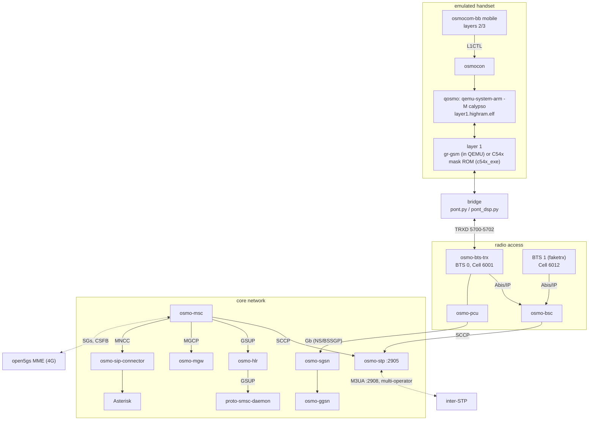
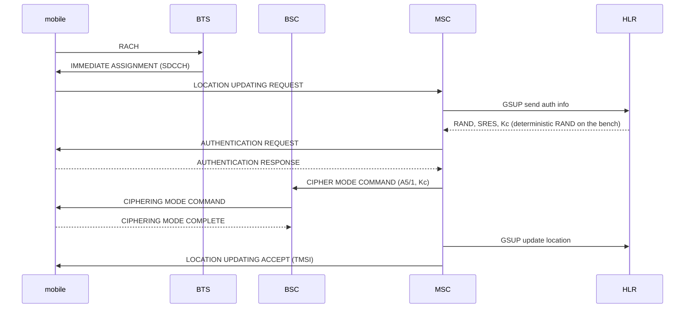
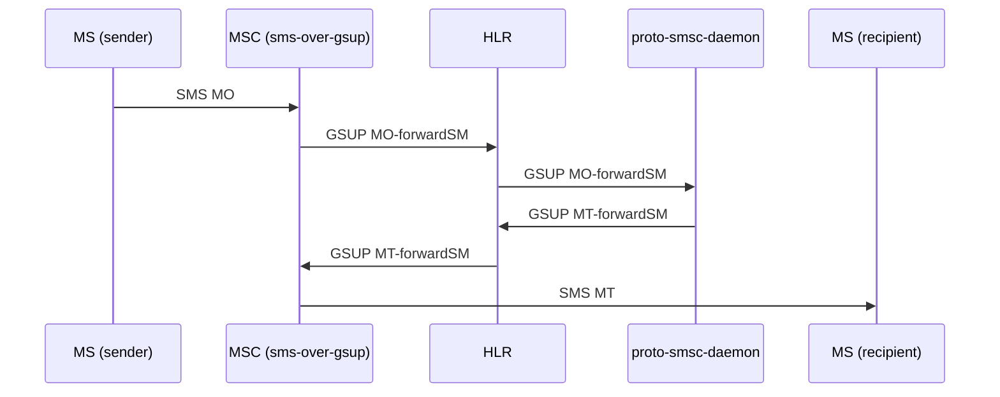
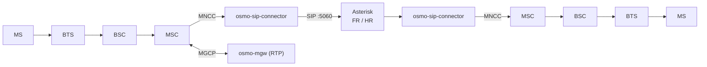

# osmo-operator — architecture

How the pieces fit: one PLMN on one machine, the emulated handset, and the
flows of a location update, an SMS and a call.

← [README](../README.md) · Details: [wiki/Reference](../wiki/Reference.md), [README-grgsm](README-grgsm.md), [README-dsp](README-dsp.md), [README-ss7](README-ss7.md), [README-lte](README-lte.md)

## The whole bench

Everything in one operator talks over `127.0.0.1`. The local STP listens on
`127.0.0.1:2905` straight away, without waiting for the Docker interface.

With `--bts`, the Calypso of QEMU runs the `trx` firmware and the host
`transceiver` application instead of `mobile` and the bridge: it is the radio
of BTS 0, and a second Calypso camps on it over the air (`pont/air.py`).

## Location update and authentication

The A3A8 patches (`patches/*-force-rand-toy.patch`) make RAND deterministic,
so a run is reproducible from one boot to the next.

## SMS

SMPP is on `:2775` with a test ESME. Between operators, `scripts/sms-interop-relay.py`
forwards over TCP 7890 ([README-ss7](README-ss7.md)).

## Voice

`600` is the Asterisk echo test: what the mobile sends comes back to it
([README-tests](README-tests.md)). On the DSP chain the FR codec runs either in
the ROM (`--vocoder-rom`, default) or on the host with gapk (`--gapk`).

## GPRS / EDGE

BSSGP/NS from the PCU to osmo-sgsn, then PDP contexts through osmo-ggsn
(GTPv1-C/U). On the DSP chain the GPRS modem is brought up by
`scripts/egprs-dsp.sh` ([README-dsp](README-dsp.md#gprs--egprs-on-the-dsp-bench)).

## Where the code lives

| path | role |
|---|---|
| `start.sh` / `start-native.sh`, `startup_scripts/` | the launcher (native, container, ISO) |
| `launch/start-docker.sh`, `compose.sh` | Docker, multi-operator |
| `launch/start-interstp.sh`, `set_stp_ip.sh` | the SS7 hub and node addressing |
| `network/` | WAN table, mesh, firewall, VirtualBox, ISM |
| `lib/gabarits.sh`, `configs/`, `generate_configs.sh`, `globals.conf` | config templates and the network settings |
| `pont/` | the radio bridges (`pont.py`, `pont_dsp.py`, `air.py`, `airmesh.py`) |
| `scripts/` | run-time services and diagnostics (SMS relay, audio, call diag, EGPRS, Magnetite) |
| `checks/` | read-only health checks |
| `iso_modules/`, `build-iso.sh` | the ISO and SD image |
| `packaging/` | `.deb` cache and standalone packages |
| `/opt/GSM/qosmo` | QEMU fork, `run.sh`, `run_modules/`, `tmux_modules/` |
| `/opt/GSM/c54x_exe`, `/opt/GSM/grgsm_exe` | external layer 1s |

The full repository layout is in the [README](../README.md#repository-layout).
