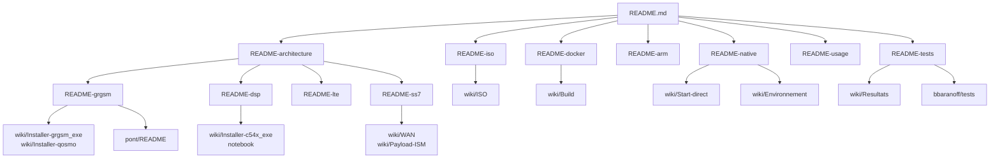
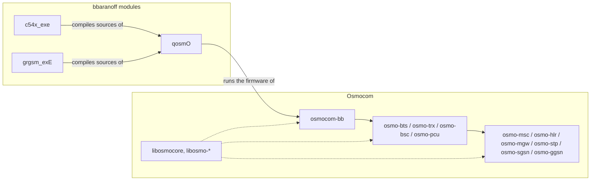

# osmo-operator — documentation map

Every document in the project, and where to start depending on what you want.

← [README](../README.md)

## Topic READMEs (this repository)

| document | subject |
|---|---|
| [README](../README.md) | entry point, quick start, index |
| [README-iso](README-iso.md) | the live ISO: download, run, launchers, contents |
| [README-docker](README-docker.md) | Docker images, build graph, `.deb` cache, Compose, PHY modes |
| [README-native](README-native.md) | `install.sh`, `start-direct.sh`, profiles, `qosmo` launcher |
| [README-arm](README-arm.md) | arm64 / Raspberry Pi 4 SD image |
| [README-architecture](README-architecture.md) | how the pieces fit, LU / SMS / call flows, code map |
| [README-grgsm](README-grgsm.md) | the gr-gsm layer 1 chain, radio diagnostics |
| [README-dsp](README-dsp.md) | the C54x mask-ROM DSP chain, current status |
| [README-lte](README-lte.md) | 4G, CSFB, postmarketOS phone |
| [README-ss7](README-ss7.md) | multi-operator, inter-STP, point codes, WAN |
| [README-usage](README-usage.md) | tmux, VTY, numbers, ports, Wireshark |
| [README-tests](README-tests.md) | `banc-max.sh` ladder, reference run, pytest, `checks/` |

## Wiki

| page | subject |
|---|---|
| [Home](../wiki/Home.md) | quick start and reference card |
| [Reference](../wiki/Reference.md) | the former full README |
| [Start-direct](../wiki/Start-direct.md) | `start-direct.sh` step by step, option manual |
| [Build](../wiki/Build.md) | `build.sh`, `build-iso.sh`, `.deb`, `install.sh` |
| [ISO](../wiki/ISO.md) | ISO contents, build, install |
| [Environnement](../wiki/Environnement.md) | variable precedence, what reaches QEMU |
| [Resultats](../wiki/Resultats.md) | reference `check_all.sh` runs |
| [Telephone-emule](../wiki/Telephone-emule.md) | the emulated phone on your own Osmocom stack |
| [Lancer-a-la-main](../wiki/Lancer-a-la-main.md) | the phone process by process |
| [Installer-qosmo](../wiki/Installer-qosmo.md) | build the QEMU fork |
| [Installer-grgsm_exe](../wiki/Installer-grgsm_exe.md) | build the gr-gsm layer 1 |
| [Installer-c54x_exe](../wiki/Installer-c54x_exe.md) | build the DSP emulator |
| [installer-osmo-jusquau-dsp.ipynb](../wiki/installer-osmo-jusquau-dsp.ipynb) | notebook: Dockerfile replayed natively |
| [SIM](../wiki/SIM.md) | real SIM in an Omnikey reader, or softSIM, over SAP |
| [WAN](../wiki/WAN.md) | linking two nodes, LAN or Internet |
| [Payload-ISM](../wiki/Payload-ISM.md) | SMS text over an ISM radio link |

## Components and their READMEs

Every piece of software the bench is built from, with a link to its own README.
"Patches" are the files of [`patches/`](../patches/) applied on top of upstream.

### bbaranoff modules

| component | role | source tree |
|---|---|---|
| [qosmO](https://github.com/bbaranoff/qosmO/blob/main/README.md) | QEMU fork `-M calypso` (ARM7TDMI + platform), `run.sh`, `run_modules/`, the `qosmo` launcher; layer 1 chosen at `configure` (`--enable-l1-grgsm` / `--enable-l1-dsp`) | `/opt/GSM/qosmo` |
| [c54x_exe](https://github.com/bbaranoff/c54x_exe/blob/main/README.md) | TMS320C54x on the TI mask ROM, outside QEMU; `pont_dsp.py`; the `--dsp` chain ([README-dsp](README-dsp.md)) | `/opt/GSM/c54x_exe` |
| [grgsm_exE](https://github.com/bbaranoff/grgsm_exE/blob/main/README.md) | gr-gsm layer 1 outside QEMU ([README-grgsm](README-grgsm.md)) | `/opt/GSM/grgsm_exe` |
| [qosmo-overlay](https://github.com/bbaranoff/qosmo-overlay/blob/main/README.md) | the files qosmO adds to / changes in upstream QEMU | `/opt/GSM/qosmo-overlay` |
| [tests](https://github.com/bbaranoff/tests) | end-to-end test suite, `banc-max.sh`, run reports ([README-tests](README-tests.md)) | `/opt/GSM/tests` |
| [osmo-egprs-web](https://github.com/bbaranoff/osmo-egprs-web) | the web dashboard on `:8080` | `/opt/GSM/osmo-egprs-web` |
| [firmware](https://github.com/bbaranoff/firmware) | prebuilt osmocom-bb firmware (`layer1.highram.elf`) | `/opt/GSM/firmware` |

### Osmocom

Upstream on [gitea.osmocom.org](https://gitea.osmocom.org); sources in `/opt/GSM/<name>`.

| component | role | patches |
|---|---|---|
| [libosmocore](https://gitea.osmocom.org/osmocom/libosmocore/src/branch/master/README.md) | core library: VTY, logging, GSM coding, GSUP |  |
| [libosmo-abis](https://gitea.osmocom.org/osmocom/libosmo-abis/src/branch/master/README.md) | Abis/IP (BTS ↔ BSC) |  |
| [libosmo-netif](https://gitea.osmocom.org/osmocom/libosmo-netif/src/branch/master/README.md) | network interface helpers (SCTP, IPA) |  |
| [libosmo-sigtran](https://gitea.osmocom.org/osmocom/libosmo-sigtran/src/branch/master/README.md) | SCCP / M3UA, and **osmo-stp** (local STP and inter-STP) |  |
| [libosmo-gprs](https://gitea.osmocom.org/osmocom/libosmo-gprs/src/branch/master/README.md) | GPRS protocol stack (RLC/MAC, LLC, SNDCP) |  |
| [libosmo-dsp](https://gitea.osmocom.org/sdr/libosmo-dsp/src/branch/master/README.md) | DSP helpers |  |
| [libsmpp34](https://gitea.osmocom.org/cellular-infrastructure/libsmpp34/src/branch/master/README.md) | SMPP 3.4 |  |
| [libgtpnl](https://gitea.osmocom.org/cellular-infrastructure/libgtpnl/src/branch/master/README.md) | kernel GTP-U through netlink |  |
| [osmo-bts](https://gitea.osmocom.org/cellular-infrastructure/osmo-bts/src/branch/master/README.md) | BTS (`osmo-bts-trx`, `osmo-bts-virtual`) | `osmo-bts-force-rand-toy` |
| [osmo-trx](https://gitea.osmocom.org/cellular-infrastructure/osmo-trx/src/branch/master/README.md) | transceiver | `osmo-trx-ipc-ts-frame-align`, `osmo-trx-rach-per-ra-table` |
| [osmo-bsc](https://gitea.osmocom.org/cellular-infrastructure/osmo-bsc/src/branch/master/README.md) | BSC |  |
| [osmo-msc](https://gitea.osmocom.org/cellular-infrastructure/osmo-msc/src/branch/master/README.md) | MSC / VLR, SMS-over-GSUP, SGs (CSFB) | `osmo-msc-force-rand-toy` |
| [osmo-hlr](https://gitea.osmocom.org/cellular-infrastructure/osmo-hlr/src/branch/master/README.md) | HLR, GSUP | `osmo-hlr-force-rand-toy` |
| [osmo-mgw](https://gitea.osmocom.org/cellular-infrastructure/osmo-mgw/src/branch/master/README.md) | media gateway (MGCP, RTP) |  |
| [osmo-sip-connector](https://gitea.osmocom.org/cellular-infrastructure/osmo-sip-connector/src/branch/master/README.md) | MNCC ↔ SIP (to Asterisk) |  |
| [osmo-pcu](https://gitea.osmocom.org/cellular-infrastructure/osmo-pcu/src/branch/master/README.md) | PCU (GPRS/EDGE) |  |
| [osmo-sgsn](https://gitea.osmocom.org/cellular-infrastructure/osmo-sgsn/src/branch/master/README.md) | SGSN |  |
| [osmo-ggsn](https://gitea.osmocom.org/cellular-infrastructure/osmo-ggsn) | GGSN (GTPv1-C/U); no top-level README.md upstream |  |
| [gapk](https://gitea.osmocom.org/osmocom/gapk/src/branch/master/README.md) | GSM audio codecs (FR/HR/EFR), audio bridge to the mobile | `gapk-pq-alsa-output-probe` |
| [osmocom-bb](https://osmocom.org/projects/baseband/wiki) | phone side: `mobile`, `trxcon`, `osmocon`, `layer1` firmware, `fake_trx` (no README in the repo: project wiki) | `osmocom-bb-*` (7 patches) |
| [gsup-smsc-proto](https://gitea.osmocom.org/themwi/gsup-smsc-proto/src/branch/master/README) | `proto-smsc-daemon` / `proto-smsc-sendmt`, the SMSC |  |
| [softsim](https://gitea.osmocom.org/sim-card/softsim/src/branch/master/README) | softSIM served over SAP ([wiki/SIM](../wiki/SIM.md)) |  |

### Third-party

| component | role | patches |
|---|---|---|
| [gr-gsm](https://github.com/ptrkrysik/gr-gsm/blob/master/README.md) | GSM receiver for GNU Radio (layer 1 of the `--grgsm` chain) | `grgsm-optional-qtgui-import`, `grgsm-receiver-publish-bsic-fn` |
| [Asterisk](https://github.com/asterisk/asterisk/blob/master/README.md) | PBX: voice, echo test 600, SIP trunks between nodes |  |
| [open5gs](https://github.com/open5gs/open5gs/blob/main/README.md) | 4G core ([README-lte](README-lte.md)) |  |
| [srsRAN 4G](https://github.com/srsran/srsRAN_4G/blob/master/README.md) | srsENB / srsUE over ZMQ |  |
| [sysmo-usim-tool](https://github.com/sysmocom/sysmo-usim-tool/blob/master/README.md) | programming the sysmoISIM |  |
| [pmbootstrap](https://gitlab.postmarketos.org/postmarketOS/pmbootstrap) | postmarketOS phone image | `pmbootstrap-osmo-bench-qemu`, `pmaports-linux-postmarketos-stable-ppp` |

## Other documents

| document | subject |
|---|---|
| [`pont/README.md`](../pont/README.md) | A5, Kc and SACCH: measurement report on the radio bridge |
| [`environment/README.md`](../environment/README.md) | environment variables and path resolution |
| [`services/README.md`](../services/README.md) | shipped systemd units |
| [`navigation/QUICKSTART.md`](../navigation/QUICKSTART.md), [`navigation/STATUS.md`](../navigation/STATUS.md) | the SS7 console |
| [bbaranoff/tests](https://github.com/bbaranoff/tests) | end-to-end test suite and run reports |
| [qosmO](https://github.com/bbaranoff/qosmO) | the QEMU fork: one base, two layer 1s |
| [c54x_exe](https://github.com/bbaranoff/c54x_exe) | the C54x DSP on the TI mask ROM |
| [grgsm_exE](https://github.com/bbaranoff/grgsm_exE) | the gr-gsm layer 1 outside QEMU |
