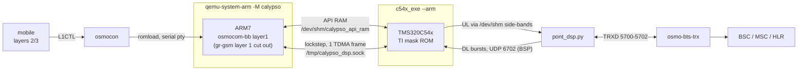

# osmo-operator — the DSP chain (`--dsp`)

With `--dsp`, the handset's own DSP takes over. A TMS320C54x core is emulated
outside QEMU ([c54x_exe](https://github.com/bbaranoff/c54x_exe)) and runs the
mask ROM dumped from a real Calypso (PROM0-3, DROM, PDROM). This has been the
default since 2026-10-01.

← [README](../README.md) · Details: [wiki/Installer-c54x_exe](../wiki/Installer-c54x_exe.md), [wiki/Start-native §8-dsp](../wiki/Start-native.md), [install notebook](../wiki/README-notebook.md), [c54x_exe README](https://github.com/bbaranoff/c54x_exe)

```bash
./start-native.sh                         # real C54x mask ROM (default)
./start-native.sh --dsp                   # the same, explicitly
MODE=dsp PONT=1 /opt/GSM/c54x_exe/run.sh  # the mobile chain alone, no network
BANC_DSP=none ./start-native.sh --dsp     # the stack only, no DSP bench
```

## How it fits together

`--dsp` does **not** select a different QEMU. The stack comes up exactly as in
gr-gsm mode (core, BTS, side-car, tmux), and only the four Calypso modules
(`qemu`, `pty`, `osmocon`, `l2`) are handed over to `c54x_exe/run.sh`:



The five steps of `c54x_exe/run.sh`:

```
1. c54x_exe --arm     the DSP: /tmp/calypso_dsp.sock + shared API RAM, DL bursts on UDP 6702
2. qemu-system-arm    the ARM + osmocom-bb layer1, gr-gsm layer 1 cut out
3. osmocon            romload on the serial pty, L1CTL relay
4. mobile             osmocom-bb layers 2/3
5. pont_dsp.py        TRXD 5700-5702 facing osmo-bts-trx
```

`--dsp` starts **no bridge of its own**: `c54x_exe/run.sh` runs one on
5700-5702 (step 5). A second one on the same ports would die on *Address
already in use*. `./start-native.sh --stop` tears down the DSP bench too,
without repeating `--dsp`.

## What the ROM does today

From the reference run of 2026-10-16
([`tout-en-un-20261016-164539.qmd`](https://github.com/bbaranoff/tests/blob/main/tout-en-un-20261016-164539.qmd),
details in [README-tests](README-tests.md)): ladder **27/27**, and on the signal
path **14 steps by the ROM, 0 by the host**.

- Handled by the ROM: FCCH detection, SCH/BSIC, BCCH SI1/2/4, SACCH SI5/6,
  RACH, SDCCH both ways, A5 on the modelled coprocessor, TCH/F downlink
  (Viterbi), FACCH and SACCH uplink, uplink TCH speech, and the ROM's FR codec
  through the voice serial port (VSP).
- End to end: camping, location update, SMS MO/MT, USSD, MO/MT calls with A5/1;
  a 1 kHz tone comes back after 0.54 s at +59.7 dB.
- Open points: `B_BFI` is still raised on bad frames and FACCH steals (masked
  by `layer1.highram_patched`), frequency hopping is not handled, and the DSP
  takes 4.3–4.6 ms of host time per 4.62 ms frame (worst DSP frame 3.37 ms on
  the reference run).

## GPRS / EGPRS on the DSP bench

`scripts/egprs-dsp.sh` (and `osmo-egprs-dsp.service`) runs the EGPRS workflow
next to the DSP mobile. The calypso layer1 firmware has no PDCH support
(`L1CTL_GPRS_*`), so the **DSP gate is closed**: the GPRS modem runs on a
virtual layer 1 (`virtphy`) in the same PLMN/LAC/RA, while the DSP mobile camps
on BTS 0.

## Building

`c54x_exe` compiles `qosmo`'s sources (it does not copy them) and needs the ROM
files in `rom/calypso_dsp.*.bin`. Step by step:
[wiki/Installer-c54x_exe](../wiki/Installer-c54x_exe.md). The
[notebook](../wiki/installer-osmo-jusquau-dsp.ipynb) replays the whole Dockerfile
natively, from apt to a call on the DSP.

Test it: `cd /opt/GSM/tests && ./banc-max.sh --dsp --restart`.
