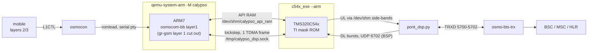

# osmo-operator — the DSP chain (`--dsp`)

With `--dsp` (the default), the handset's own DSP takes over. A TMS320C54x core
is emulated outside QEMU ([c54x_exe](https://github.com/bbaranoff/c54x_exe))
and runs the mask ROM dumped from a real Calypso (PROM0-3, DROM, PDROM).

← [README](../README.md) · Details: [wiki/Installer-c54x_exe](../wiki/Installer-c54x_exe.md), [wiki/Start-native §8](../wiki/Start-native.md), [install notebook](../wiki/README-notebook.md), [c54x_exe README](https://github.com/bbaranoff/c54x_exe)

```bash
./start-native.sh                         # real C54x mask ROM (default)
./start-native.sh --dsp                   # the same, explicitly
MODE=dsp PONT=1 /opt/GSM/c54x_exe/run.sh  # the mobile chain alone, no network
BANC_DSP=none ./start-native.sh --dsp     # the stack only, no DSP bench
```

## How it fits together

`--dsp` does **not** select a different QEMU. The stack comes up exactly as in
gr-gsm mode (core, BTS, side-car, tmux), and only the four Calypso modules
(`qemu`, `pty`, `osmocon`, `l2`) are handed over to `c54x_exe/run.sh`:



The five steps of `c54x_exe/run.sh`:

```
1. c54x_exe --arm     the DSP: /tmp/calypso_dsp.sock + shared API RAM, DL bursts on UDP 6702
2. qemu-system-arm    the ARM + osmocom-bb layer1, gr-gsm layer 1 cut out
3. osmocon            romload on the serial pty, L1CTL relay
4. mobile             osmocom-bb layers 2/3
5. pont_dsp.py        TRXD 5700-5702 facing osmo-bts-trx
```

`--dsp` starts **no bridge of its own**: `c54x_exe/run.sh` runs one on
5700-5702 (step 5). A second one on the same ports would die on *Address
already in use*. `./start-native.sh --stop` tears down the DSP bench too,
without repeating `--dsp`.

Instances: `INSTANCE=N` runs a second complete chain next to the first
(`/dev/shm/calypsoN`, `/tmp/osmocom_l2_N`, `/tmp/c54x-pontN`); the bench
aliases `banc-mobile` (instance 2, over the air) and `banc-rssi` (instance 4)
use it. Per-instance settings live in `instances/instance-N.env`.

Firmware: `/opt/GSM/firmware/board/compal_e88/layer1.highram.elf` by default
(`FIRMWARE_ELF=` for another binary, `FIRMWARE_FLASH=` for a flash image such
as Magnetite, see [magnetite](magnetite.md)). The highram firmware is loaded
through `loader.compalram.bin`; with GPRS it no longer fits the 64 KiB the
Compal boot loader accepts, so no compalram variant of `layer1` is built.

## What the ROM does

- Handled by the ROM: FCCH detection, SCH/BSIC, BCCH SI1/2/4, SACCH SI5/6,
  RACH, SDCCH both ways, A5 on the modelled coprocessor, TCH/F downlink
  (Viterbi), FACCH and SACCH uplink, uplink TCH speech, and the ROM's FR codec
  through the voice serial port (VSP, `--vocoder-rom`, default; `--gapk`
  moves the vocoder to the host).
- End to end: camping, location update, SMS MO/MT, USSD, MO/MT calls with
  A5/1, echo test 600.
- Real time: the DSP has to process one 4.62 ms TDMA frame within the frame;
  the bridge clock follows the DSP (`PONT_HORLOGE_MAX`, see
  [README-grgsm](README-grgsm.md#diagnosing-the-radio-side)).

The ladder in [README-tests](README-tests.md) checks every step of this list
on a running bench.

## GPRS / EGPRS on the DSP bench

`scripts/egprs-dsp.sh` (and `services/osmo-egprs-dsp.service`) brings up the
EGPRS workflow next to the DSP mobile:

```bash
scripts/egprs-dsp.sh [start|stop|status|check] [--l1 auto|virtphy|dsp] [--no-banc] [--regen-gprs] [--all]
```

| step | what it does |
|---|---|
| preflight | binaries, the 7 DSP ROM files, `c54x_exe`, the osmocom-bb `modem`; checks whether the `layer1` firmware handles `L1CTL_GPRS_*` (PDCH) |
| configs | `/etc/osmocom`: the virtual EGPRS BTS 2 in `osmo-bsc.cfg` (`configs/gprs/osmo-bsc-bts2-egprs.frag`, re-inserted after each `--regen`), `osmo-bts-virtual-gprs.cfg`, `osmo-pcu-gprs.cfg`, `modem-gprs.cfg` |
| banc | `osmo-banc.service` (`start-native.sh --dsp`) |
| abonne | the modem's IMSI in the HLR (idempotent) |
| cellule | `osmo-bts-virtual` (BTS 2, Um multicast on `lo`) + `osmo-pcu` as transient systemd units |
| modem | GPRS attach (GMM) + PDP context (SM), tun in the `msgprs` netns; verified at the SGSN and by a ping from the netns |

Layer 1 of the modem (`--l1`, or `EGPRS_L1`): `auto` picks `dsp` when the
firmware source handles `L1CTL_GPRS_*` and `virtphy` otherwise. With `dsp` the
`modem` replaces `mobile` on the DSP bench's L1CTL socket (`/tmp/osmocom_l2`),
the GPRS firmware `layer1.highram.gprs.elf` and `UL_RAW=1` are written to
`/etc/default/osmo-banc` (restart `osmo-banc` to load them), and the bench must
be running in DSP mode (`c54x_exe --arm` present). With `virtphy` the modem
runs on a virtual layer 1 in the same PLMN/LAC/RA while the DSP mobile camps on
BTS 0. The Calypso ROM modulates GMSK only (CS-1..4): 8-PSK (MCS-5..9) stays
on the virtphy modem.

Logs: `journalctl -u osmo-egprs-dsp`, `-u osmo-modem-gprs`, `-u osmo-pcu-gprs`,
`-u osmo-bts-virtual-gprs`, `-u osmo-virtphy-gprs`.

## Building

`c54x_exe` compiles `qosmo`'s sources (it does not copy them) and needs the ROM
files in `rom/calypso_dsp.*.bin`. Step by step:
[wiki/Installer-c54x_exe](../wiki/Installer-c54x_exe.md). The
[notebook](../wiki/installer-osmo-jusquau-dsp.ipynb) replays the whole Dockerfile
natively, from apt to a call on the DSP. The GPRS `layer1` firmware is rebuilt
with `sudo ./addition.sh --calypso-fw` (gnuarm toolchain required).

Test it: `cd /opt/GSM/tests && ./banc-max.sh --dsp --restart`.

## Known issues

- TCH/F downlink: `B_BFI` is raised on really bad frames and on FACCH steals;
  the audio is handled by the codec's error concealment.
- Frequency hopping is not handled.
- The emulated DSP uses most of the 4.62 ms frame budget on the host; a slow
  host loses real time (the bridge then slows the clock, see `PONT_HORLOGE_MAX`).
- PDCH on the C54x depends on the GPRS `layer1` firmware being loaded by the
  bench; `egprs-dsp.sh --l1 virtphy` is the path that does not depend on it.
