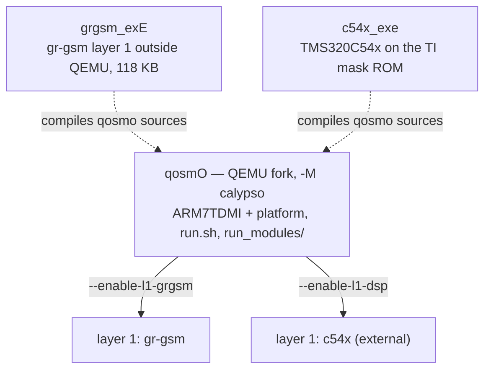
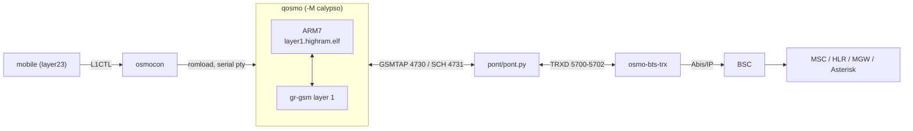

# osmo-operator — the gr-gsm layer 1

`--grgsm` runs the handset with gr-gsm as layer 1. This chain works end to
end: camping, location update, authentication, A5/1, SMS and voice calls. Use
it to get work done. To study the real DSP instead, see [README-dsp](README-dsp.md).

← [README](../README.md) · Details: [wiki/Installer-grgsm_exe](../wiki/Installer-grgsm_exe.md), [wiki/Installer-qosmo](../wiki/Installer-qosmo.md), [wiki/Lancer-a-la-main](../wiki/Lancer-a-la-main.md), [`pont/README.md`](../pont/README.md)

```bash
./start-direct.sh --grgsm
```

## The two layer-1 chains

Both chains run the same core network, the same BTS and the same `mobile`. They
differ in **who demodulates the air interface**.

| | **`--grgsm`** | **`--dsp`** (default since 2026-10-01) |
|---|---|---|
| Layer 1 | gr-gsm inside QEMU + `grgsm_exe` bridge | real TI mask-ROM C54x, **outside** QEMU |
| QEMU's job | ARM7 + gr-gsm layer 1 | ARM7 only (`CALYPSO_DSP_EXTERN=1`) |
| Bridge | `pont/pont.py` | `pont/pont_dsp.py` |
| Mobile VTY | 4247 | 4347 (4247 on the 2026-10-16 reference run) |

## One QEMU tree, two layer 1s

Since 2026-09-25 there is a **single QEMU tree**. The layer 1 is a `configure`
option, not a separate repository.



| tree | what it is |
|---|---|
| [`/opt/GSM/qosmo`](https://github.com/bbaranoff/qosmO) | the QEMU fork |
| [`/opt/GSM/grgsm_exe`](https://github.com/bbaranoff/grgsm_exE) | the gr-gsm layer 1 outside QEMU, 118 KB against the 93 MB `qemu-system-arm` that normally hosts it |
| [`/opt/GSM/c54x_exe`](https://github.com/bbaranoff/c54x_exe) | the DSP, see [README-dsp](README-dsp.md) |

`qemu-system-arm -M help` names the layer 1 actually linked in:

| configure | `-M help` shows |
|---|---|
| (nothing) | `couche 1 : aucune` |
| `--enable-l1-grgsm` | `couche 1 : grgsm` |
| `--enable-l1-dsp` | `couche 1 : c54x` |

## The chain



To start it process by process, with proof at each step:
[wiki/Lancer-a-la-main](../wiki/Lancer-a-la-main.md). To plug only the emulated
phone into your own Osmocom stack: [wiki/Telephone-emule](../wiki/Telephone-emule.md).

## Diagnosing the radio side

**Read [`pont/README.md`](../pont/README.md) before chasing a radio fault through a
CRC counter.** The causes documented there (overwritten Kc, the SACCH L1
header, C0 filling, an inert `CALYPSO_CANNED`) *all* show up as "the bridge
has CRC errors".

```bash
./start-direct.sh --check-paths     # verify the declared dependencies
./start-direct.sh --verbose         # show the modules' output
```

| log | contents |
|---|---|
| `/var/log/osmocom/qemu.log` | ARM/DSP emulation, BSP, IRQ |
| `/var/log/osmocom/bridge.log` | QEMU ticks, IND CLOCK, DL/UL bursts |
| `/var/log/osmocom/run.sh.log` | orchestration |

| symptom | likely cause | check |
|---|---|---|
| `bridge: timeout` | QEMU never started the TPU/DSP | `grep TINT0 /var/log/osmocom/qemu.log` |
| `FBSB result=255` (no cell) | layer 1 does not detect the FB | `grep "IMR change" /var/log/osmocom/qemu.log \| wc -l` |
| `osmo-bts-trx: PC clock skew too high` | the bridge stopped sending `IND CLOCK` | restart the bridge |
| `/tmp/osmocom_l2` never created | the firmware does not boot | `head -50 /var/log/osmocom/qemu.log` |
| *Address already in use* on 5700 | two bridges: a `--dsp` run left one behind | `./start-direct.sh --stop` |

QEMU monitor: `socat - unix-connect:/tmp/qemu-calypso-mon.sock`.
`--assembly-logs` gives an instruction trace of the emulated ARM
(`-d in_asm,exec,nochain`). It is very large and the bench no longer runs in
real time, so use it only to chase the firmware.

Test it: `cd /opt/GSM/tests && ./banc-max.sh --grgsm --restart`
([README-tests](README-tests.md)).
