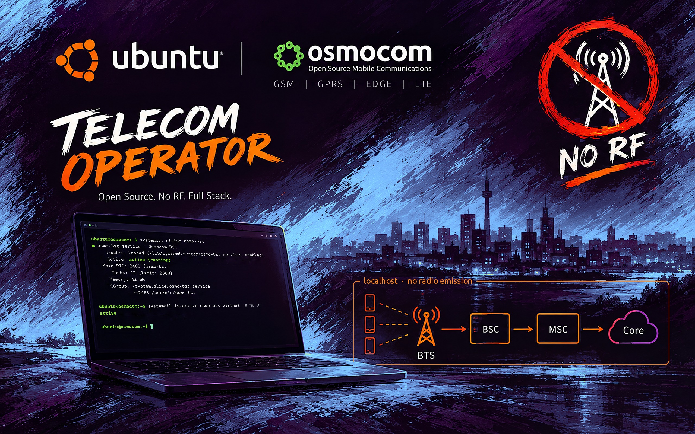

# osmo-operator — the live ISO

The fastest path: a GNOME live image with the whole bench (2G, DSP, 4G, CSFB,
postmarketOS phone), Wireshark, Linphone and the I/Q spectra. Nothing to
compile or configure.



← [README](../README.md) · Details: [wiki/ISO](../wiki/ISO.md), [wiki/Home](../wiki/Home.md), [wiki/Build](../wiki/Build.md)

| | |
|---|---|
| **Live ISO password** | `osmo` |
| **postmarketOS phone password** | `147147` |
| **Minimum host** | x86_64, 8 GB RAM, 4 cores, nested virtualization in a VM |
| **Image identity** | `IMAGE_VERSION="OSMO_EGPRS_V2"` · `OSMO_ROLE=operator` · `OSMO_LITE=0` |

## Download

[Latest release](https://github.com/bbaranoff/osmo-operator/releases/latest), or:

- [Google Drive (single file)](https://drive.usercontent.google.com/download?id=1fDvbBzfdxir6JM7MM_zlAm5Rtef5RnGB&export=download&authuser=1)
- GitHub v0.1-9:
  [part-00](https://github.com/bbaranoff/osmo-operator/releases/download/v0.1-9/osmo-operator-desktop.iso.part-00) ·
  [part-01](https://github.com/bbaranoff/osmo-operator/releases/download/v0.1-9/osmo-operator-desktop.iso.part-01) ·
  [part-02](https://github.com/bbaranoff/osmo-operator/releases/download/v0.1-9/osmo-operator-desktop.iso.part-02) ·
  [part-03](https://github.com/bbaranoff/osmo-operator/releases/download/v0.1-9/osmo-operator-desktop.iso.part-03) ·
  [SHA256SUMS](https://github.com/bbaranoff/osmo-operator/releases/download/v0.1-9/SHA256SUMS)

> [!IMPORTANT]
> Download **every** `.part-NN` file, not just the first one. GitHub caps release
> files at 2 GiB, so the image ships in pieces.

```bash
cat osmo-operator-desktop.iso.part-* > osmo-operator-desktop.iso
sha256sum -c --ignore-missing SHA256SUMS
```

## Run the image

The live root is a tmpfs (~6 GB in `toram` mode). Logs and captures are bounded
and purged at every boot. The bench runs two QEMUs (Calypso and pmOS): in a VM,
**enable nested virtualization**, or the phone VM falls back to software
emulation and becomes very slow.

**QEMU**

```sh
qemu-system-x86_64 -cdrom osmo-operator-desktop.iso -m 8G -enable-kvm \
  -cpu host -smp 4 -nic user,hostfwd=tcp::8080-:8080
```

**VirtualBox**

1. New VM: Linux / Ubuntu 64-bit, 8 GB, 4 CPUs, 3D off.
2. System → Processor: tick *Nested VT-x/AMD-V*
   (if greyed out: `VBoxManage modifyvm "<name>" --nested-hw-virt on`).
3. ISO on the optical drive. No disk is needed.
4. NAT port forward: host 8080 → guest 8080.

**VMware**: new VM from the ISO, Linux / Ubuntu 64-bit, 8 GB, 4 cores, tick
*Virtualize Intel VT-x/EPT or AMD-V/RVI*, skip Easy Install.

**USB stick** (hybrid ISO, boots UEFI or BIOS):

```sh
sudo dd if=osmo-operator-desktop.iso of=/dev/sdX bs=4M status=progress conv=fsync
```

On Windows, use Rufus in *DD Image* mode. On real hardware KVM is available
directly, which is the most comfortable setup.

## Getting started

Three launchers are pinned in the dock. 2G and 4G are independent and can start
in any order. **Launch the smartphone last**, once both networks are up.

| | Launcher | What it starts |
|:---:|---|---|
|  | **2G** (red handset) | The GSM core and the emulated radio: osmo-stp / bsc / msc / hlr / sgsn / ggsn / pcu, the Calypso under QEMU, the two BTS and the two osmocom-bb mobiles, Asterisk, the SMSC. |
|  | **4G** (signal bars) | open5gs, srsENB and srsUE over ZMQ, and the SGs interface to the MSC (CSFB). See [README-lte](README-lte.md). |
| 📱 | **Smartphone** | The postmarketOS VM: oFono on the virtual modem, data on 4G, voice and SMS on 2G. |

From a terminal, the same 2G bench, on the Calypso DSP instead of gr-gsm:

```sh
cd /opt/GSM/osmo-operator && sudo ./start-native.sh --dsp
```

`--menu` asks interactively (layer 1 `grgsm_exe` or `c54x_exe`). Check that
everything is in place with `checks/diag-stp-operator.sh`, or the full suite in
[README-tests](README-tests.md).

## What's inside

- **2G / GSM (Osmocom)**: osmo-stp (M3UA, SCTP :2905), osmo-bsc, osmo-msc,
  osmo-hlr, osmo-sgsn, osmo-ggsn, osmo-pcu, osmo-mgw (MGCP :2427). Two DCS1800
  cells in LAC 1: BTS 0 (Cell ID 6001, BSIC 7) and BTS 1 (Cell ID 6012,
  BSIC 8). GPRS/EDGE, voice through Asterisk (SIP :5060), SMS-over-GSUP with
  SMPP :2775, A3A8 with a deterministic RAND so that runs are reproducible,
  live GSMTAP capture.
- **The emulated Calypso**: `qemu-system-arm -M calypso -cpu arm946` runs
  `layer1.highram.elf`, loaded by `osmocon` exactly as on a C123. See
  [README-grgsm](README-grgsm.md).
- **The DSP**: the Calypso's TMS320C54x on TI's real mask ROM, with
  `--dsp`. See [README-dsp](README-dsp.md).
- **4G, CSFB and postmarketOS**: see [README-lte](README-lte.md).

## Installing to disk and building the ISO

The live image installs with Calamares. The accounts are the ones from the
*Users* screen plus an unlocked root, LUKS is offered in the partitioning
choices, and a *Graphics drivers* page offers `nvidia-driver-610` when `lspci`
sees a card.

`sudo ./build-iso.sh` does **one** Docker build (`osmocom-nitb`) and derives
each rootfs from it: interstp, normal, lite (normal without the workshops),
desktop. Options, modules (`iso_modules/NN-*.sh`) and CI are covered in
[wiki/ISO](../wiki/ISO.md) and [wiki/Build](../wiki/Build.md). The Raspberry Pi
image is in [README-arm](README-arm.md).
