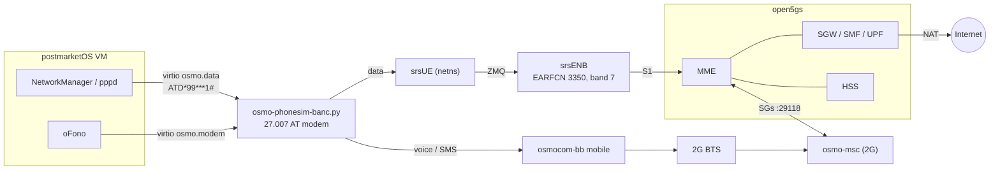
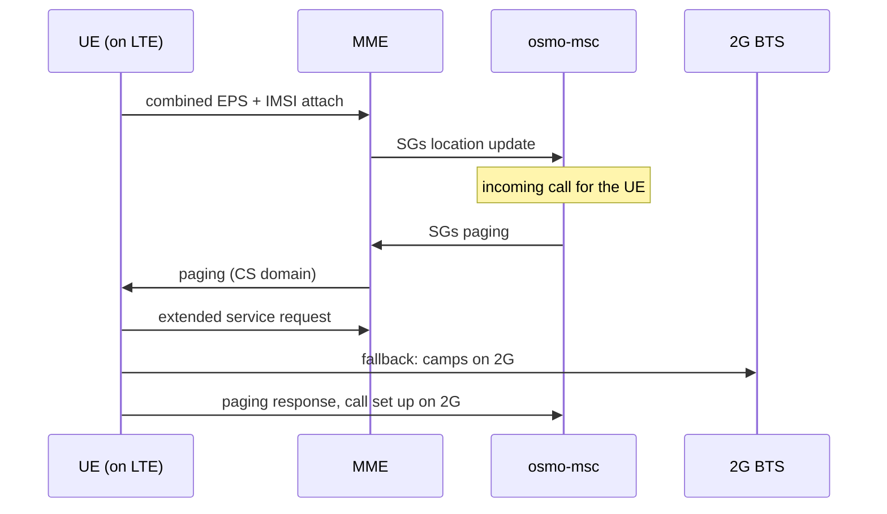

# osmo-operator — 4G, CSFB and the postmarketOS phone

On top of the 2G bench: an LTE network (open5gs + srsRAN over ZMQ, no SDR),
tied to the GSM core by SGs for **CSFB**, and a postmarketOS phone VM that does
data on 4G and voice/SMS on 2G under the same identity.

← [README](../README.md) · Details: [wiki/ISO](../wiki/ISO.md), [wiki/Home](../wiki/Home.md), [wiki/Telephone-emule](../wiki/Telephone-emule.md)

Available on amd64 only. srsRAN and Open5GS are not built for arm64 ([README-arm](README-arm.md)).

## Overview

## 4G / LTE

- open5gs core (MME, SGW-C/U, SMF, UPF, PCRF, HSS) on dedicated loopbacks,
  Prometheus :9090, WebUI :9999, MongoDB behind the HSS.
- PLMN 001/01, TAC 7. NAS null ciphering (EIA2/EIA1 + EEA0) on purpose: this is
  an analysis bench, and NAS reads in clear in Wireshark.
- srsENB (10 MHz, EARFCN 3350, band 7) and srsUE over ZMQ. Milenage test
  subscriber IMSI 001010001000001. The UE gets an IP in a netns and reaches the
  Internet through NAT.

Shipped in `/opt/LTE`, launched with `osmo-lte` and `osmo-epc`
(`tools/osmo-lte.sh`, `tools/osmo-epc.sh`), or the **4G** launcher in the dock.

## CSFB

- SGs between osmo-msc and the MME (:29118), mapping
  `TAI (001-01, TAC 7) → LAI (001-01, LAC 1)`.
- Combined EPS+IMSI attach: an incoming call is paged by the MME and the UE
  falls back to the BTS.
- Two subscribers (100101, 100102), one per cell, wired for an inter-cell call
  with fallback.

## postmarketOS: the phone

- x86_64 pmOS VM with a patched kernel (`CONFIG_PPP` enabled, missing
  upstream). The prebuilt kernel is in `/opt/user_interface/kernel/pmos/`.
  Password `147147`.
- 4G data: NetworkManager → pppd (`ATD*99***1#`) → virtio-console `osmo.data`
  → `osmo-phonesim-banc.py` → UE netns → srsUE → srsENB → UPF → Internet.
- 2G voice and SMS: virtio-console `osmo.modem`, where `osmo-phonesim-banc.py`
  plays a 27.007 AT modem driven by oFono. No dongle.
- Audio: two duplex PulseAudio chains (GAPK bridge to the osmocom-bb mobile,
  and an echo-cancelled chain).

Tools: `tools/osmo-pmos*.sh` (build, install, setup, QEMU), and a patched
`pmbootstrap` in `/opt/user_interface/pmos`. **Launch the phone last**, once 2G
and 4G are up.

Test it: `cd /opt/GSM/tests && ./banc-max.sh --4g` ([README-tests](README-tests.md)).
