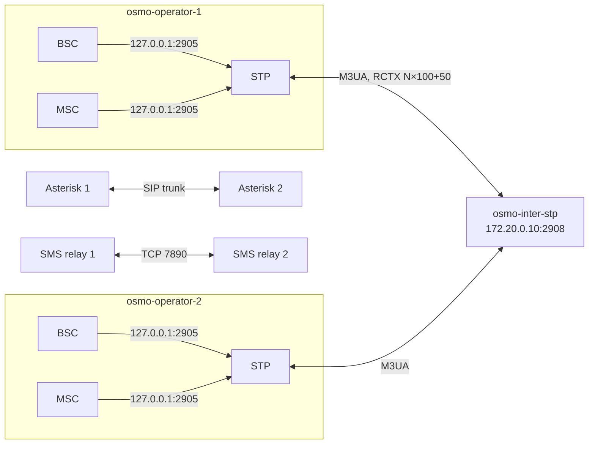
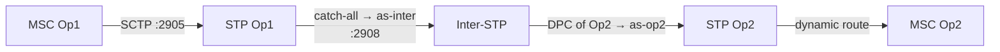
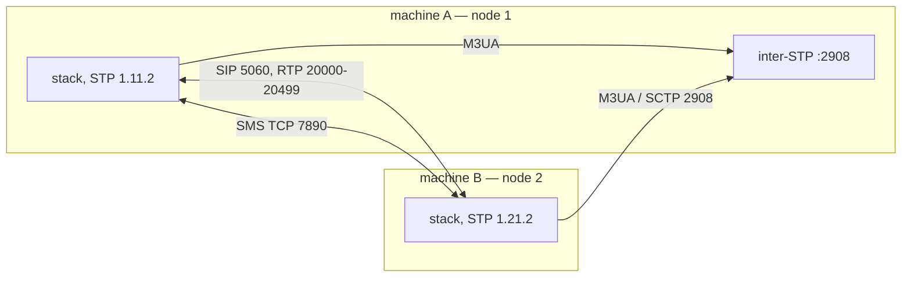

# osmo-operator — multi-operator, SS7 and WAN

The standalone bench is one operator. The bench also runs **N operators (1 to
9)**, each with its own core network, joined by a central **inter-STP** that
routes M3UA/SCCP between them, on one host (Docker) or across machines (WAN).
No configuration file is edited by hand: pjsip, dialplan, SMS routing and the
inter-STP config are all generated from N.

← [README](../README.md) · Details: [wiki/WAN](../wiki/WAN.md), [wiki/Payload-ISM](../wiki/Payload-ISM.md), [wiki/Start-native §7-wan](../wiki/Start-native.md), [wiki/Reference §9](../wiki/Reference.md#9-multi-operator-and-ss7)

## On one host (Docker)

```bash
sudo ./launch/start-docker.sh          # choose bridge mode, enter N operators
sudo ./launch/start-docker.sh stop
```



| Docker network | range | role |
|---|---|---|
| `gsm-inter` | `172.20.0.0/24` | interop backbone (inter-STP M3UA), inter-STP at `.10`, operator N at `.(10+N)` |
| `gsm-net-opN` | `172.20.N.0/24` | operator N private network |

Start order matters: the inter-STP must listen on `:2908` **before** the
operator STPs connect.

## Point codes and routing contexts

The single-host plan is `N.23.<role>`. As soon as operators are spread over
several **nodes**, the node goes into the point code, otherwise three nodes would
present the same address to the hub:

| plan | point code | routing context |
|---|---|---|
| single host | `N.23.<role>` (inter-STP `0.23.0`) | `rctx_inter = N×100+50` |
| WAN | `1.<node><op>.<role>`, role 1=MSC 2=STP 3=BSC (inter-STP `0.0.0`) | `node×1000 + op×100 + 50` |

The inter-STP uses **AS without a routing key** (catch-all per operator) and
routes on the DPC alone. Each operator STP sends unknown PCs to `as-inter`
through a `0.0.0/0` catch-all route.



## SMS and voice between operators

- **SMS**: `sms-interop-relay.py` watches the `proto-smsc-daemon` MO log, parses
  the GSM 03.40 TPDU, looks up `sms-routing.conf` (longest prefix), and forwards
  over TCP 7890 to the target relay. That relay resolves MSISDN→IMSI on its HLR
  and calls `proto-smsc-sendmt`.
- **Voice**: a SIP trunk between the operators' Asterisk instances.

Numbering on the WAN works like a country code. Node N has prefix `NN` (11,
22…), and a mobile's MSISDN is `<node>00<op><ms>`. From node 1, dial `22` +
`20011` to reach the first mobile of node 2. The sending node strips the prefix.

## Across machines (WAN)

```bash
./start-native.sh --wan                                       # interactive
./start-native.sh --wan-nodes "1:IP:11 2:IP:22" --wan-id 1    # scriptable
./start-native.sh --wan mynode2.conf                          # from another node's card
./start-native.sh --gen-conf                                  # write this node's card, start nothing
./start-native.sh --regen-conf …                              # rebuild the WAN table from scratch
./start-native.sh --virtualbox=3                              # mesh with VirtualBox VMs
./start-native.sh --air-mesh                                  # mesh the BURSTS: a shared radio medium
./start-native.sh --payload-ism                               # SMS text over an ISM radio link
```

`--node N` picks the node number **at launch**, so one ISO serves all nine
nodes. One node runs the inter-STP (`--interstp`), the others point at it with
`--hub-ip`.



Over the Internet, put the nodes in a **WireGuard** tunnel: SCTP does not cross
consumer NAT, and the table address must be both reachable and local. The full
method (tunnel, firewall, start order, layer-by-layer checks, common failures)
is in [wiki/WAN](../wiki/WAN.md).

## Diagnosing PROHIB routes

```bash
sudo checks/diag-interstp.sh        # from the hub: who is attached, PROHIB routes, flapping
sudo checks/diag-stp-operator.sh    # from an operator node
sudo checks/ss7_check.sh
```

A healthy operator STP route table:

```
N.23.1/14   as-dyn-…  avail  avail  dyn   ← MSC (dynamic)
N.23.3/14   as-dyn-…  avail  avail  dyn   ← BSC (dynamic)
0.0.0/0     as-inter  avail  avail        ← catch-all to the inter-STP
```

| symptom | likely cause | fix |
|---|---|---|
| route `0.0.0/0` PROHIB | inter-STP down, or wrong IP | check the hub IP and the backbone IP |
| PROHIB towards a node that was switched off | stale entry in `/etc/osmo-wan.conf` | `--regen-conf` on the node that runs the hub |
| no dynamic routes | MSC/BSC not reaching the local STP | check that the ASPs point at `127.0.0.1` |
| ASP DOWN on the inter-STP | Docker race | `docker restart` the operator |

The SS7 console (`ss7-console.py`, [`navigation/QUICKSTART.md`](../navigation/QUICKSTART.md))
sends MAP queries across the interconnect.

Test it: `cd /opt/GSM/tests && ./banc-max.sh --multi` ([README-tests](README-tests.md)).
