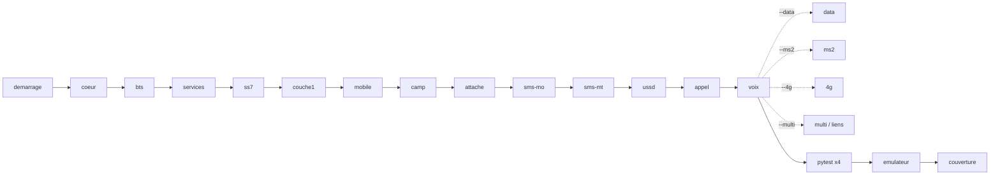

# osmo-operator — tests and reference results

Two families of tests:

- **[bbaranoff/tests](https://github.com/bbaranoff/tests)** (cloned in
  `/opt/GSM/tests`) climbs the bench **element by element**, from core to voice,
  and says how high it got. This is the end-to-end test suite.
- **`checks/`** in this repository is a set of read-only diagnostics of a running
  stack (daemons, SS7, interconnect, WAN, directory).

← [README](../README.md) · Details: [wiki/Resultats](../wiki/Resultats.md), [wiki/Start-native](../wiki/Start-native.md)

## Reference run

The reference report is
[`tout-en-un-20261016-164539.qmd`](https://github.com/bbaranoff/tests/blob/main/tout-en-un-20261016-164539.qmd),
a Quarto report of `banc-max.sh` in **DSP mode** (layer 1 = real TI mask ROM).
Render it with `quarto render tout-en-un-20261016-164539.qmd` (self-contained
HTML). A healthy bench reproduces these results: **27/27 rungs, 0 failures**,
14 signal-path steps handled by the ROM and none on the host.

| # | rung | expected result |
|---|---|---|
| 1 | demarrage | full stop, then `start-native.sh --dsp`: core up |
| 2 | coeur | processes + VTY 4258 4239 4254 4242 4243 |
| 3 | bts | osmo-bts-trx, VTY 4241 |
| 4 | services | asterisk 5060, sip-connector, `/tmp/sendmt_socket` |
| 5 | ss7 | `ss7_check` with no failure, `diag-stp-operator` |
| 6 | checks-existants | `global_check`, `call-diag`, `audio-diag` with no failure |
| 7 | couche1 | `c54x_exe --arm`, `qemu-system-arm`, `osmocon`, `pont_dsp.py` |
| 8 | mobile | VTY 4247, IMSI 001010001000001 |
| 9 | camp | ARFCN 514 (DCS), CGI 001-01-1-6001 |
| 10 | attache | MM idle normal service, in the VLR, MSISDN 100101 |
| 11 | sms-mo | SMS to 100102, RP-ACK |
| 12 | sms-mt | MSC delivered 1 → 2 |
| 13 | ussd | `*#100#` → 100101, `*#101#` → IMSI |
| 14 | appel | CC ACTIVE |
| 15 | voix | 1 kHz tone comes back, energy concentrated in 950–1050 Hz |
| 16–20 | data, ms2, 4g, multi, liens | skipped unless `--data`, `--ms2`, `--4g`, `--multi` |
| 21–24 | pytest infra / couche1 / mobile / reseau | passed |
| 25 | pytest-legacy | skipped unless `--legacy` |
| 26 | emulateur | ISA examples checked against the reference, no BC divergence |
| 27 | couverture | layer-1 coverage, see below |

Layer-1 coverage (`couverture.txt`): every step from FCCH detection to CHANNEL
RELEASE is **handled by the ROM**, including A5 on the coprocessor and uplink
TCH speech; the DSP stays within the 4.62 ms frame budget. Open points are
listed under [Known issues](#known-issues).

## The ladder: `banc-max.sh`

The bench stacks a dozen elements that depend on each other: no core means no
BTS, no layer 1 means no mobile, and without camping there is no attach, SMS or
call. When something does not work, the useful question is **how far it got**.
The last rung reached names the first faulty element.



One module per rung, in [`modules/NN-name.sh`](https://github.com/bbaranoff/tests/tree/main/modules),
played in numeric order. It never fixes anything: every verdict is a reading
made at test time, with MSC counters taken as deltas.

```bash
cd /opt/GSM/tests
./banc-max.sh                       # default: = --dsp --restart --continue, ROM vocoder (io-handler l1phy)
BANC_VOCODEUR=hote ./banc-max.sh    # same, with gapk on the host instead of the ROM vocoder
./banc-max.sh --campagne            # grgsm then dsp (each restarted, up to voice) + PDF
./banc-max.sh --dsp --restart       # one mode, restart the stack in it
./banc-max.sh --grgsm               # one mode, on the running stack
./banc-max.sh --full                # both layer 1s, 4G and inter-operator, up to voice
./banc-max.sh --ms2 --data          # also the MS#1 -> MS#2 and GPRS rungs
./banc-max.sh --only=camp,attache   # only these rungs
./banc-max.sh --list                # the rungs, in order
```

Results land in `/root/banc-max-<date>/` (`verdict.txt`, `couverture.txt`, VTY
captures, pytest reports, grafcets). Everything runs detached
(`CALYPSO_NO_ATTACH=1`), never in an interactive tmux.

## Run report: `tout-en-un.py`

[`tout-en-un.py`](https://github.com/bbaranoff/tests/blob/main/tout-en-un.py)
gathers the `.log .sh .md .mmd .py .txt` of the tests and of the last
`/root/banc-max-*` into **one Quarto/Markdown file**, shortened without loss:
identical files are cited once, repeated lines become `×N`, and lines that differ
only by numbers become a template plus the list of values. `.mmd` files are
rendered as Mermaid diagrams.

```bash
./tout-en-un.py                                 # /opt/GSM/tests + the last /root/banc-max-*
./tout-en-un.py /root/banc-max-<date>           # a given run
SORTIE=/tmp/run.qmd EXCLURE="banc-max-*" ./tout-en-un.py
```

`qmd-worker/` serves these reports on the web (Cloudflare Worker).

## pytest suites

[`pytest/`](https://github.com/bbaranoff/tests/tree/main/pytest) reads the
**live** stack (logs, VTY). The four suites are called by rungs 21–24, and each
writes `test_results.md`, a grafcet and Mermaid diagrams:

| file | suite |
|---|---|
| [`test_10_infra.py`](https://github.com/bbaranoff/tests/blob/main/pytest/test_10_infra.py) | processes, ports, VTY |
| [`test_20_couche1_grgsm.py`](https://github.com/bbaranoff/tests/blob/main/pytest/test_20_couche1_grgsm.py) / [`test_21_couche1_dsp.py`](https://github.com/bbaranoff/tests/blob/main/pytest/test_21_couche1_dsp.py) | layer 1, per chain |
| [`test_30_mobile.py`](https://github.com/bbaranoff/tests/blob/main/pytest/test_30_mobile.py) | the osmocom-bb mobile |
| [`test_40_reseau.py`](https://github.com/bbaranoff/tests/blob/main/pytest/test_40_reseau.py) | network: LU, SMS, call |
| [`test_50_actif.py`](https://github.com/bbaranoff/tests/blob/main/pytest/test_50_actif.py) | active tests |

```bash
cd /opt/GSM/tests/pytest && ./run_tests.sh
```

Other tools in the repository: `sms-rafale.sh` (SMS burst),
`inject.py`, `log_timeline.py`, `rapport.py`, and
[`rom-tx/`](https://github.com/bbaranoff/tests/tree/main/rom-tx) (uplink
encoding by the ROM, block injection).

## `checks/`: diagnostics of a running stack

All read-only. `check_all.sh` chooses what makes sense on this node, runs from
general to specific, and gives one verdict per check and an exit code.

```bash
sudo checks/check_all.sh            # everything relevant here
sudo checks/check_all.sh --dump     # + vty-debug-dump and its summary (daemons in DEBUG, several MB)
```

| script | looks at |
|---|---|
| `global_check.sh` | every daemon: STP, HLR, MSC, BSC, BTS, PCU, SGSN, Asterisk, SMS relay |
| `ss7_check.sh` | signalling: ASPs, ASs, routes, inter-STP |
| `diag-stp-operator.sh` | the interconnect from an operator node: config vs running daemon, SCTP to the hub |
| `diag-interstp.sh` | the interconnect from the hub: who is attached, who is missing, PROHIB routes, flapping |
| `wan_ss7_check.sh` | what crosses between machines (only when `/etc/osmo-wan.conf` exists) |
| `annuaire.sh` | the subscriber directory, checked against what the network knows |
| `vty-debug-dump.sh` + `operator_summary.sh` | full VTY dump, then a per-operator summary |

`wiki/Resultats.md` holds the reference `check_all.sh` runs (1 native operator;
3 operators with the inter-STP) and explains the known deviations.

Targeted diagnostics in `scripts/`:

```bash
scripts/call-diag.sh            # call path MS -> MSC -> MNCC -> sip-connector -> Asterisk
scripts/audio-diag.sh           # /dev/snd -> ALSA -> PulseAudio -> mobile l1phy
scripts/banc-repro.sh --calls 5 # a reproducible experiment for an intermittent fault
navigation/test-console.sh      # every command of the SS7 console, with a report
```

## CI

The GitHub workflows (`.github/workflows/`) build the images and the ISO. They
do not run the radio bench. The ladder needs a full stack with QEMU and is run
on a real machine.

## Known issues

- TCH/F downlink quality (`B_BFI`) is DEGRADED in the coverage report: really
  bad frames and FACCH steals, masked by `layer1.highram_patched`.
- Frequency hopping is NOT HANDLED (outside this setup).
- MVKD/MVDK guard, uplink speech ring and host vocoding are NOT OBSERVED by the
  coverage rung.
- 3 of the emulator rung's ISA examples fail and some are not assembled.
