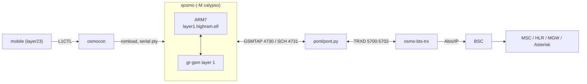
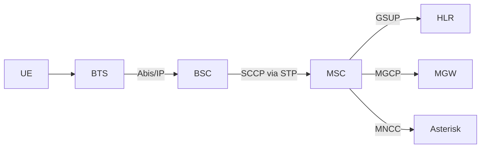
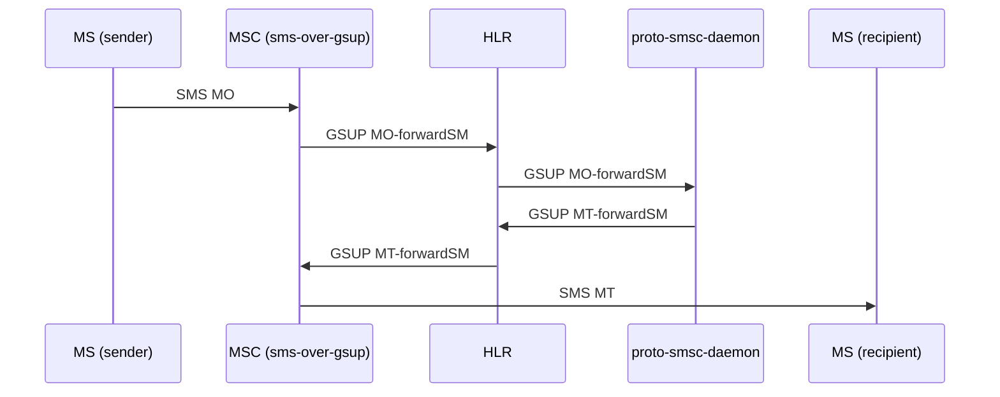
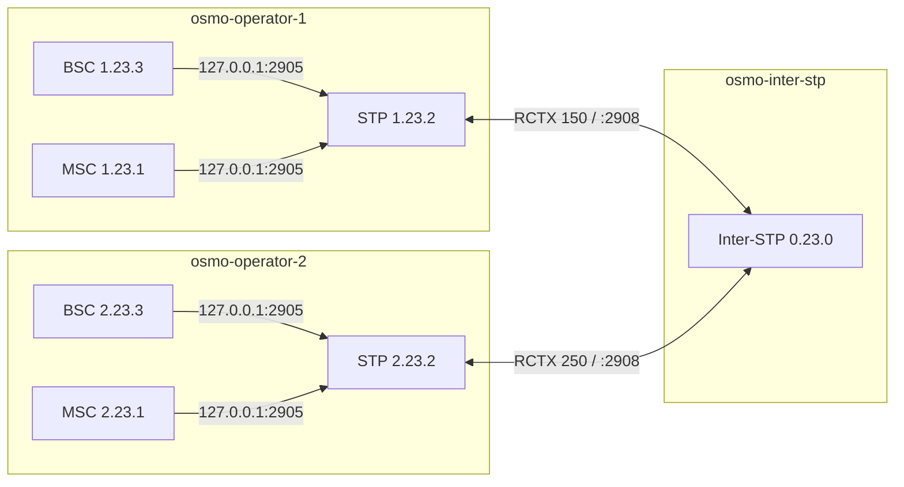
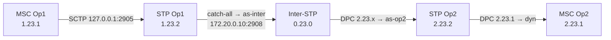

> Full reference, moved here from the top-level `README.md` on 2026-10-18.
> The new [README](../README.md) is an index pointing to the topic READMEs and to this wiki.

# osmo-operator-desktop.iso

[](https://github.com/bbaranoff/osmo-operator/actions/workflows/build-iso.yml)

Full desktop ISO :  
[Google Drive link](https://drive.usercontent.google.com/download?id=1fDvbBzfdxir6JM7MM_zlAm5Rtef5RnGB&export=download&authuser=1)  

Four Part Github desktop ISO :  
[Github link Desktop Part 00](https://github.com/bbaranoff/osmo-operator/releases/download/v0.1-7/osmo-operator-desktop.iso.part-00)  
[Github link Desktop Part 01](https://github.com/bbaranoff/osmo-operator/releases/download/v0.1-7/osmo-operator-desktop.iso.part-01)  
[Github link Desktop Part 02](https://github.com/bbaranoff/osmo-operator/releases/download/v0.1-7/osmo-operator-desktop.iso.part-02)  
[Github link Desktop Part 03](https://github.com/bbaranoff/osmo-operator/releases/download/v0.1-7/osmo-operator-desktop.iso.part-03)  
[Github link Sha256](https://github.com/bbaranoff/osmo-operator/releases/download/v0.1-7/SHA256SUMS)
  
> [!IMPORTANT]
> Download **every** `.part-NN` file, not just the first one. GitHub caps release
> files at 2 GiB, so the image ships in pieces.

```bash
cat osmo-operator-desktop.iso.part-* > osmo-operator-desktop.iso
sha256sum -c --ignore-missing SHA256SUMS
```
A complete **GSM + LTE operator on a single live image**, with a GNOME desktop for
everything that can't be driven from the VTY.
**No SDR and no physical phone**: the radio is emulated end to end, all the way
down to the baseband.


| | |
|---|---|
| **Live ISO password** | `osmo` |
| **postmarketOS phone password** | `147147` |
| **Minimum host** | x86_64, 8 GB RAM, 4 cores, nested virtualization in a VM |
| **Image identity** | `IMAGE_VERSION="OSMO_EGPRS_V2"` · `OSMO_ROLE=operator` · `OSMO_LITE=0` |

**Contents**

- [Download](../doc/README-iso.md#download)
- [Run the image](#run-the-image) — QEMU, VirtualBox, VMware, USB stick
- [Getting started](#getting-started) — the three dock launchers
- [What's inside](#whats-inside) — 2G, DSP, 4G, CSFB, postmarketOS
- [Building and running from source](#osmo-operator--a-full-gsm-network-on-one-machine)

---
  
## Run the image

The live root is a tmpfs (~6 GB in `toram` mode); logs and captures are bounded
and purged at every boot. The bench runs two QEMUs (Calypso + pmOS): in a VM,
**enable nested virtualization**, or the phone VM falls back to software
emulation and becomes very slow.

### QEMU

```sh
qemu-system-x86_64 -cdrom osmo-operator-desktop.iso -m 8G -enable-kvm \
  -cpu host -smp 4 -nic user,hostfwd=tcp::8080-:8080
```

### VirtualBox

1. New VM: Linux / Ubuntu 64-bit, 8 GB, 4 CPUs, 3D off.
2. System → Processor: tick *Nested VT-x/AMD-V*
   (if greyed out: `VBoxManage modifyvm "<name>" --nested-hw-virt on`).
3. ISO on the optical drive — no disk needed.
4. NAT port forward: host 8080 → guest 8080.

### VMware

New VM from the ISO, Linux / Ubuntu 64-bit, 8 GB, 4 cores, tick
*Virtualize Intel VT-x/EPT or AMD-V/RVI*, skip Easy Install.

### USB stick (hybrid ISO)

```sh
sudo dd if=osmo-operator-desktop.iso of=/dev/sdX bs=4M status=progress conv=fsync
```

On Windows, use Rufus in *DD Image* mode. Boots UEFI or BIOS. On real hardware
KVM is available directly — the most comfortable setup.

---

## Getting started

Three launchers are pinned in the dock. 2G and 4G are independent and can start
in any order; **launch the smartphone last**, once both networks are up.

| | Launcher | What it starts |
|:---:|---|---|
|  | **2G** — the red handset | The GSM core and the emulated radio: osmo-stp / bsc / msc / hlr / sgsn / ggsn / pcu, the Calypso under QEMU, the two BTS and the two osmocom-bb mobiles, Asterisk, the SMSC. |
|  | **4G** — the signal bars | open5gs, srsENB and srsUE over ZMQ, and the SGs interface to the MSC (the CSFB). |
| 📱 | **Smartphone** — the Adwaita phone icon | The postmarketOS VM: oFono on the virtual modem, data on 4G, voice and SMS on 2G. |

Run the 2G handset on the Calypso DSP instead of gr-gsm:

```sh
cd /opt/GSM/osmo-operator && sudo ./start-native.sh --dsp
```

`--menu` asks interactively (layer 1 `grgsm_exe` or `c54x_exe`).
Check that everything is in place with `checks/diag-stp-operator.sh`.

---

## What's inside

<details open>
<summary><b>2G / GSM — Osmocom</b></summary>

- Full core: osmo-stp (M3UA, SCTP :2905), osmo-bsc, osmo-msc, osmo-hlr, osmo-sgsn, osmo-ggsn (GTPv1-C/U), osmo-pcu, osmo-mgw (MGCP :2427).
- Two DCS1800 cells in LAC 1: BTS 0 (Cell ID 6001, BSIC 7) and BTS 1 (Cell ID 6012, BSIC 8), each on its own osmo-bts-trx.
- **A real emulated Calypso as layer 1**: `qemu-system-arm -M calypso -cpu arm946` ([qosmo](https://github.com/bbaranoff/qosmO)) runs `layer1.highram.elf`, loaded by `osmocon` exactly as on a C123. `pont.py` turns bursts into I/Q for `fake_trx.py`, then `trxcon` and two osmocom-bb `mobile` instances on the terminal side.
- GPRS/EDGE: BSSGP/NS to the PCU, PDP contexts through osmo-ggsn.
- Voice: external MNCC → Asterisk (SIP :5060, FR/HR) via osmo-sip-connector.
- SMS: SMS-over-GSUP → proto-smsc-daemon, SMPP :2775 with a test ESME, inter-operator relay :7890.
- A3A8 with deterministic RAND (`*-force-rand-toy` patches): the bench is reproducible from one boot to the next.
- Live GSMTAP capture, ready for Wireshark.

</details>

<details>
<summary><b>The DSP — the Calypso's TMS320C54x on TI's real mask ROM</b></summary>

- Default demodulator: gr-gsm ([grgsm_exe](https://github.com/bbaranoff/grgsm_exE)). With `./start-native.sh --dsp`, the baseband's own DSP takes over: a C54x core emulated outside QEMU ([c54x_exe](https://github.com/bbaranoff/c54x_exe)), running the mask ROM dumped from a real Calypso (PROM0-3, DROM, PDROM).
- ARM (QEMU) and DSP share the API RAM through `/dev/shm/calypso_api_ram` and run in lockstep, one TDMA frame at a time, over `/tmp/calypso_dsp.sock`. Downlink bursts reach the DSP's serial port (BSP) over UDP 6702 via `pont_dsp.py`.
- What the ROM does by itself (bench runs of 2026-09-23): FCCH/SCH acquisition, BCCH decoding (SI1-4), camping, location update, SMS MO/MT, MO/MT calls with A5/1 and speech audible both ways.
- **Still a work bench, not the demo path**: every TCH/F frame is flagged BFI even though speech stays intelligible, SACCH occasionally drops a call, the SB window is rarely armed, and the DSP needs 4.3–4.6 ms of host time per 4.62 ms frame. Details in the [c54x_exe README](https://github.com/bbaranoff/c54x_exe).

</details>

<details>
<summary><b>4G / LTE — open5gs + srsRAN</b></summary>

- open5gs core (MME, SGW-C/U, SMF, UPF, PCRF, HSS…) on dedicated loopbacks, Prometheus :9090, WebUI :9999, MongoDB behind the HSS.
- PLMN 001/01, TAC 7. NAS null ciphering (EIA2/EIA1 + EEA0) on purpose: it's an analysis bench, NAS reads in clear in Wireshark.
- srsENB (10 MHz, EARFCN 3350, band 7) and srsUE over ZMQ, no SDR. Milenage test subscriber IMSI 001010001000001; the UE gets an IP in a netns and reaches the Internet through NAT.

</details>

<details>
<summary><b>CSFB — tying 2G and 4G together</b></summary>

- SGs between osmo-msc and the MME (:29118), mapping `TAI (001-01, TAC 7) → LAI (001-01, LAC 1)`.
- Combined EPS+IMSI attach: an incoming call is paged by the MME and the UE falls back to the BTS.
- Two subscribers (100101, 100102), one per cell, wired for an inter-cell call with fallback.

</details>

<details>
<summary><b>postmarketOS — the phone</b></summary>

- x86_64 pmOS VM with a patched kernel (`CONFIG_PPP` enabled, missing upstream); prebuilt kernel in `/opt/user_interface/kernel/pmos/`.
- 4G data: NetworkManager → pppd (`ATD*99***1#`) → virtio-console `osmo.data` → `osmo-phonesim-banc.py` → UE netns → srsUE → srsENB → UPF → Internet.
- 2G voice and SMS: virtio-console `osmo.modem`, where `osmo-phonesim-banc.py` plays a 27.007 AT modem driven by oFono. No dongle.
- Audio: two duplex PulseAudio chains (GAPK bridge to the osmocom-bb mobile, and an echo-cancelled chain).
- Result: data on 4G, voice and SMS on 2G, same identity — a real CSFB handset's behaviour at modem level.

</details>

---

# osmo-operator — a full GSM network on one machine

A complete Osmocom GSM core (BTS, BSC, MSC, HLR, MGW, SMSC, Asterisk) plus an
**emulated Calypso handset** — no radio hardware, no SIM card, no phone. The
handset runs the real OsmocomBB `layer1` firmware on an emulated TI Calypso
baseband, camps on the cell, authenticates, ciphers, sends SMS and holds a
voice call.

Everything below is the **standalone bench**: one operator, one machine. That is
what you want first, and it is what most of this document is about. Multi-operator
SS7 interconnect exists and is covered in [§9](#9-multi-operator-and-ss7), but you
do not need it to get a phone on the air.

---

## 1. Quick start

### 1.1 From the published image

```bash
sudo  docker pull ghcr.io/bbaranoff/osmo-operator/osmocom-nitb:latest
git clone https://github.com/bbaranoff/osmo-operator
cd osmo-operator
sudo ./launch/start-docker.sh
```

Then enter the container and bring the stack up:

```bash
sudo docker exec -ti osmo-operator-1 bash

cd /opt/GSM/osmo-operator
./start-native.sh --regen     # regenerate configs from the templates (first run)
./start-native.sh --stop      # make sure nothing is left over
./start-native.sh             # start the bench
```

`start-native.sh` attaches to tmux at the end. You are looking at a live GSM
network with a mobile camped on it.

### 1.2 Native, without Docker

The repository installs directly on Ubuntu 24.04 (noble — the same base as the
Dockerfile):

```bash
sudo ./install.sh                  # everything: deps, sources, build, binaries, configs, desktop
./install.sh --list                # show the steps, do nothing
./install.sh --check               # what is already in place
sudo ./install.sh --reinstall      # replay everything
sudo ./install.sh --only bureau    # desktop icons and shortcuts only
```

The launcher is the same `./start-native.sh`, which delegates to
`/opt/GSM/qosmo/run.sh`.

### 1.3 Stopping

```bash
./start-native.sh --stop      # stops the stack AND the DSP bench, with or without --dsp
./start-native.sh --status    # what is running
```

`--stop` never needs `--dsp` to be repeated: it tears down the C54x bench too,
so the next start finds a clean machine.

---

## 2. The two layer-1 chains

This is the one choice that matters on the standalone bench. Both run the same
core network, the same BTS and the same `mobile`; they differ in **who
demodulates the air interface**.

| | **`--grgsm`** | **`--dsp`** (default since 2026-10-01) |
|---|---|---|
| Layer 1 | gr-gsm inside QEMU + `grgsm_exe` bridge | real TI mask-ROM C54x, **outside** QEMU |
| QEMU's job | ARM7 + gr-gsm layer 1 | ARM7 only (`CALYPSO_DSP_EXTERN=1`) |
| Bridge | `pont/pont.py` | `pont/pont_dsp.py` |
| Status | end to end: camping, LU, auth, A5/1, SMS, voice call | camping, SI1-4, LU; TCH calls reach end to end but every speech frame is flagged `B_BFI` |
| Use it for | getting work done | studying the real DSP |

```bash
./start-native.sh             # real C54x mask ROM (default)
./start-native.sh --dsp       # the same, explicitly
./start-native.sh --grgsm     # gr-gsm layer 1 (the former default)
```

### 2.1 Three trees, one QEMU

Since 2026-09-25 there is a **single QEMU tree**. The old `qosmo-grgsm` and
`qosmo-dsp` forks are gone — they had no common root commit, so a platform fix
had to be reapplied by hand in the other tree and, in practice, was not.

| tree | what it is |
|---|---|
| [`/opt/GSM/qosmo`](https://github.com/bbaranoff/qosmO) | the QEMU fork: `-M calypso`, ARM7TDMI + platform. Carries `run.sh`, `run_modules/`, `cfgs/`. The layer 1 is a `configure` option, not a repository: `--enable-l1-grgsm` or `--enable-l1-dsp`. |
| [`/opt/GSM/c54x_exe`](https://github.com/bbaranoff/c54x_exe) | the TMS320C54x running **outside** QEMU on the real TI mask ROM (`rom/calypso_dsp.*.bin`). Compiles `qosmo`'s sources — it does not copy them. |
| [`/opt/GSM/grgsm_exe`](https://github.com/bbaranoff/grgsm_exE) | the gr-gsm layer 1 outside QEMU. 118 KB against the 93 MB `qemu-system-arm` that normally hosts it. |

`qemu-system-arm -M help` names the layer 1 actually linked in — the shortest way
to know what you built:

| configure | `-M help` shows |
|---|---|
| (nothing) | `couche 1 : aucune` |
| `--enable-l1-grgsm` | `couche 1 : grgsm` |
| `--enable-l1-dsp` | `couche 1 : c54x` |

### 2.2 The gr-gsm chain (default)



### 2.3 The DSP chain (`--dsp`)

`--dsp` does **not** select a different QEMU. The stack comes up exactly as in
gr-gsm mode — core, BTS, side-car, tmux — and only the four Calypso modules
(`qemu`, `pty`, `osmocon`, `l2`) are handed over to `c54x_exe/run.sh`, which runs
five steps of its own:

```
1. c54x_exe --arm     the DSP: /tmp/calypso_dsp.sock + shared API RAM,
                      DL bursts on UDP 6702
2. qemu-system-arm    the ARM + osmocom-bb layer1, gr-gsm layer 1 cut out
3. osmocon            romload on the serial pty, L1CTL relay
4. mobile             osmocom-bb layers 2/3
5. pont_dsp.py        TRXD 5700-5702 facing osmo-bts-trx, bursts down to the
                      DSP, uplink through the /dev/shm side-bands
```

```bash
./start-native.sh --dsp                   # the full stack, then the DSP bench
MODE=dsp PONT=1 /opt/GSM/c54x_exe/run.sh  # the mobile chain alone, no network
BANC_DSP=none ./start-native.sh --dsp     # the stack only, no DSP bench
```

`--dsp` starts **no bridge of its own**: `c54x_exe/run.sh` runs its own on
5700-5702 (step 5). A second one on the same ports would die on *Address already
in use* and leave a corpse behind at every start.

Step details and variables: [`wiki/Start-native.md`](Start-native.md) § 8-dsp.

### 2.4 Profiles

The layer-1 flag is independent of the **profile**, which chooses how many
base stations come up and how:

| profile | stack |
|---|---|
| `faketrx-qemu` (default) | core + BTS#0 QEMU + BTS#1 faketrx — also `hybrid` |
| `faketrx` | core + `fake_trx` + `trxcon` + `mobile` |
| `qemu` | the Calypso QEMU pipeline alone |
| `noproc` | core only — also `core` |

```bash
./start-native.sh faketrx
./start-native.sh --profile qemu
./start-native.sh --list        # show the plan without running it
./start-native.sh --dry-run     # walk through it with no side effects
```

---

### 2.5 The Calypso as the BTS transceiver (`--osmo-trx`)

[2026-10-19] A third shape of the DSP chain: the emulated phone no longer
camps on BTS#0, it *is* BTS#0's radio. QEMU boots `trx.highram.elf` (the
`trx` app of Sylvain Munaut's transceiver branch, tree
`/opt/GSM/osmocom-bb-transceiver`), and the host app `transceiver` from the
same tree replaces both `mobile` and the bridge: it talks L1CTL to the phone
through osmocon and exposes the TRXD UDP interface (5700-5702) that
`osmo-bts-trx` already expects. The rest of the stack (BSC, MSC, side-car)
comes up unchanged.

```
./start-native.sh --bts               # [2026-10-20] alias of --osmo-trx ; implies --dsp ; c54x_exe/run.sh runs with OSMO_TRX=1
./start-native.sh --bts --ms          # the BTS radio, then the second phone over the air (INSTANCE=2, see 2.7)
```
(`--ms` alone, or no option, is the usual mobile + bridge setup.)

What changes in `c54x_exe/run.sh` when `OSMO_TRX=1`: step 2 loads
`trx.highram.elf`, step 4 launches `transceiver -l /tmp/osmocom_l2 -m 0x01 -M 0x01 -b 7
--no-sync -e 3` instead of `mobile`, step 5 (the bridge) is skipped because the
transceiver holds the same ports. `OSMO_TRX_TS_MASK` (default `0x01`: TS0
only, BCCH/CCCH) widens the timeslot set later; `OSMO_TRX_ARGS` and
`TRANSCEIVER` override the arguments and the binary.

The host app needed four things the 2013 code did not have; they live in
`patches/osmocom-bb-transceiver-qemu-bench.patch`, applied by the Dockerfile
right after the clone and by `install_modules/40-patches.sh` natively:
`--no-sync` (there is no cell to FBSB on inside QEMU: BTS mode as soon as the
phone resets), `--ts-mask`, `--l1ctl`/`--base-port`, and `SETTSC`,
`SETFORMAT` (TRXD v0 answered) and `NOMTXPOWER` acknowledged, since
`osmo-bts-trx` 1.10 treats them as critical.

Verified on 2026-10-20 (bench run): the DSP extcode runs on `c54x_exe`
(extended NDB at 0x2400 `active=1, tsc=7`), BTS#0 gets its clock from the
firmware's frame number and comes up; the TRX emits FB and SB one burst in ten
each plus the BCCH/CCCH normal bursts of the BTS (`[rom-tx] ... NB n, SB n, FB n`
in `/tmp/c54x-pont/dsp.log`). Four things had to change to get there:

* `-m` only sets the **RX** mask now; the TX mask is `-M` (`OSMO_TRX_TX_MASK`,
  default `0x01`). The firmware (`prim_bts.c`) opens its TX window at TPU slot
  `(tx_start + 5) & 7`, three slots ahead of the downlink timeslot it serves,
  and used to serve TS0 only with the upstream multi-window mask `0xe3`
  (`tx_start == 5`, slot 3) while putting `tn = 1` for any other mask: with
  `-m 0x01` applied to TX too, every burst was a dummy. The patched firmware
  computes `SLOT = (8 - tx_start) & 7`, `tn = tx_start + SLOT`, so a single
  window (`0x01`) serves TS0; `c54x_exe` only plays one TX window per frame.
* `osmo-bts-trx` sends its bursts `fn-advance` frames ahead of the clock; the
  default (2) left them 1-4 frames early and the firmware discarded most of
  them (`STALE BURST` in osmocon.log). `configs/osmo-bts-trx.cfg` now has
  `osmotrx fn-advance 20` / `rts-advance 5` (the osmo-trx values).
* `osmo-bts-trx` **exits** when its transceiver disappears ("No more clock from
  transceiver"), i.e. after every `banc-stop`; `run.sh` relaunches it at step
  4b when BTS#0 is absent (`OSMO_TRX_BTS_RELANCE=0` to disable). Wait for the
  old process to finish its shutdown (up to a minute) before `banc-trx`.
* The SCH the extcode encodes comes out half wrong on `c54x_exe`: compared with
  `gsm0503_sch_encode()` of the `sch` words of the extended page, the first 39
  coded bits are exact and the last 39 (upper info bits, CRC-10 parity, tail)
  are ~50 % wrong, so the mobile's ROM read `crc_ko` at TOA 23 on every SB. The
  encoder lives in the DSP extension code (`dsp_extcode.c`), not in the ROM: a
  C54x instruction of that loop is emulated wrongly (to find). Meanwhile
  `c54x_exe` re-encodes the SCH before publishing it (`MONTANT_ROM_TX_SB_RECODE`,
  default on in TRX mode; `[rom-tx] SB recode` counts the wrong bits).

* The TRX's uplink: the mobile's bursts arrive through the air tagged with
  their GSM frame number (the mobile's `a_a5fn`), and the BSP of instance 1 has
  no SB to learn the firmware's clock from. `c54x_exe` now decodes the `sch`
  word of each SB it publishes (fn F emitted at tick T) and sets the BSP's
  fn/tick offset to `F - T + delta` (`calypso_bsp_trx_calage()`,
  `CALYPSO_BSP_TRX=1`, `CALYPSO_BSP_TRX_DELTA` default -1: the uplink burst of
  fn X is read in the DSP frame where the downlink burst fn X+1 goes out), so an
  uplink burst is played at the frame where `l1s_bts_resp` tags it with its own
  fn. `[ts0] mode TRX : offset fn-tick pose a ...` in `/tmp/c54x-pont/dsp.log`.

* The firmware's BTS "sync" task (`prim_bts_sync.c`, one normal-burst read
  on TS0 every 51 frames: it is what produces the `DATA_IND` the host turns
  into `IND CLOCK`) fed its TOA and frequency measurements into the TA and AFC
  loops. On the bench there is no cell to follow, and the first mobile burst
  that landed in that window (`freq_err=3967`) shifted the TPU and the
  frequency, the task stopped reporting, the clock stopped and osmo-bts-trx
  exited ("No more clock from transceiver"). The patch removes both loops from
  that task and keeps the measurement trace and the `DATA_IND`.

* The host re-sends `BTS_MODE` on every `SETRXGAIN`, `SETSLOT`, `HANDOVER`
  and `NOHANDOVER` command, and osmo-bts-trx sends one right after the RACH
  (channel activation). The firmware's handler did `l1a_mftask_set(0)` and
  re-enabled the BTS tasks, which killed the sync task mid-run: the clock
  stopped two seconds after every channel request. The handler is now
  idempotent: once in BTS mode it only updates the parameters.

* The real killer of the clock, found last: once the BSP of the TRX instance
  had stored its first uplink burst, `bsp_attendre_trame()` waited up to 40 ms
  at every tick whose frame had no burst (the mobile-side rule "a late BTS
  frame is worth waiting for"). Uplink bursts are rare (a RACH, then four
  bursts per SDCCH block), so the DSP/ARM lockstep collapsed two seconds after
  the mobile's first RACH: the firmware programmed nothing any more (121 DSP
  instructions per frame), no `DATA_IND`, no clock, osmo-bts-trx exited. In TRX
  mode (`g_trx_cale`) the BSP no longer waits: a frame without a burst is
  silence.

* With all four bursts of a block reaching the BTS at the right frame numbers,
  the SABM still did not decode: a capture of the TRXD uplink (TRX → BTS, UDP
  source port 5702) showed nearly all-zero bits, and the result words the
  extension code leaves for `l1s_bts_resp` (`d[5..33]`) were empty while the
  mobile's bursts were full. Like its SCH encoder, the extcode's normal-burst
  demodulator yields nothing right on `c54x_exe`. Second prosthesis
  (`calypso_bsp_trx_ul_prothese()`, `CALYPSO_BSP_TRX_UL=0` to disable): the
  BSP remembers the uplink NB it played, and at the next frame's phase A
  `c54x_exe` writes its exact bits into the result page the ARM is about to
  read (`[ts0] prothese montante` in dsp.log; the "bits already right" counter
  measures how far the emulated demodulator is from working). The RACH keeps
  its own path (I/Q to the host) and was never affected.
* `BTS_RX_LAG` (prim_bts.c) is 3 instead of 2 and the BSP delta -2: one frame
  of margin for the air's latency, without which three bursts out of four of
  each uplink block arrived after their window.

Still open: `DSP Error Status: 24` printed every frame by the trx firmware
(DMA_PROG|DMA_TASK, known since 2026-09-22, harmless so far), and the C54x
emulation bug behind the SCH prosthesis.

### 2.6 The C123 screen and keypad under QEMU

[2026-10-19] Three SoC devices were added to `qosmo` (`hw/arm/calypso/`):
`calypso_armio.c` (the ARMIO block at 0xFFFE4800: the 5x5 key matrix, IRQ 8,
as `calypso/keypad.c` scans it), `calypso_i2c_ctrl.c` (the real I2C
controller at 0xFFFE2800, previously swallowed by the catch-all stub) and
`calypso_st7558.c` (the 96x65 LCD, I2C slave 0x3c). Any firmware app that
draws and reads keys now works: `rssi`, `menu`, `hello_world`, `trx`.

* The screen is published in `/dev/shm/calypso_lcd` (`CALYPSO_LCD_SHM`) on
  every flush, and also on the QEMU graphic console (`-display sdl`).
* Keys arrive on the Unix datagram socket `/tmp/calypso_keys.sock`
  (`CALYPSO_KEYS_SOCK`): `press 5`, `release 5`, `tap menu 200`. Key names:
  `0`-`9`, `star`, `hash`, `menu`, `lsb`, `rsb`, `up`, `down`, `left`,
  `right`, `ok`, `power`. `CALYPSO_KEYS_DEBUG=1` traces them on stderr.
* `tools/osmo-c123-gtk.py` (run with `/usr/bin/python3`) shows the photo of
  the phone from `data/c123.jpg`, overlays the live LCD in the `lcd` zone of
  `data/c123-zones.json` and sends a press/release for each key clicked; the
  PC keyboard works too. `--calibrate` redraws the zones with the mouse.

```
FIRMWARE_APP=rssi bash /opt/GSM/c54x_exe/run.sh     # steps 1-3 only: DSP, QEMU, osmocon
/usr/bin/python3 tools/osmo-c123-gtk.py              # the phone window
echo "tap menu" | socat - UNIX-SENDTO:/tmp/calypso_keys.sock   # or by hand
```

### 2.7 Two Calypsos and the air between them

[2026-10-19] With `--osmo-trx` the emulated phone is the BTS radio, so a second
emulated phone is needed to be the mobile. `c54x_exe/run.sh INSTANCE=2` runs a
complete second chain (DSP, QEMU, osmocon, mobile) next to the first. It re-executes
itself in a private mount namespace where `/dev/shm` is the host's
`/dev/shm/calypso2`, so none of the hard-coded `/dev/shm/...` paths of c54x_exe or
qosmo had to change; the host's real `/dev/shm` stays readable at
`/run/calypso-shm-hote`. Everything else is shifted: `/tmp/c54x-pont2`,
`/tmp/osmocom_l2_2`, `/tmp/calypso_dsp2.sock`, gdb 1235/44445, keypad socket
`/tmp/calypso_keys2.sock`, BSP UDP port 6712, mobile VTY +100, 4347 (a derived copy of
`mobile_pont.cfg`).

The air is `pont/air.py`: each c54x_exe publishes the bursts its ROM emits in the
ring `calypso_tx_rom` (now including the SB, dummy and FB bursts of a BTS, and
one per frame in TRX mode), and each BSP accepts bursts in TRXDv0 over UDP. The
relay feeds A's ring to B's BSP and B's ring to A's BSP. It is step 5 of
instance 2 (`AIR=1`), in place of the bridge, which must not touch 5700.

```
banc-trx          # instance 1 : the BTS radio (restart it after a rebuild of c54x_exe or trx.highram)
banc-mobile       # instance 2 : the mobile, plus the air ; banc-mobile-stop / -status / -logs
c123-2            # its screen and keypad
```

First run on 2026-10-20: the air carries the TRX's bursts to the mobile
(`/tmp/c54x-pont2/air.log`: `A->B n (NB SB DUMMY FB)`), the mobile's ROM detects
the FCCH (`FB1 ... TOA=8759`) and receives the SB in its SB window
(`[sbwin] ... FENETRE SB (one-shot)` in `/tmp/c54x-pont2/dsp.log`); the SB
only decodes once the TRX side re-encodes it (see 2.5). The two instances are
not slaved to each other: each runs real time (4.62 ms per frame) and the
mobile's BSP waits up to 40 ms for a late frame. `air.py` keeps the relayed
frame numbers continuous across a restart of `banc-trx` (the TRX publishes its
tick as fn, which restarts at 0; without the offset the mobile's BSP waited
for a frame in the future: "le DSP court devant le BTS").

**2026-10-20, 19:30 — first location update through the two Calypsos**:
`LOCATION UPDATING ACCEPT (lai=001-01-1)`, `got TMSI 0x28a6ecbc`,
`TMSI REALLOCATION COMPLETE` in `/tmp/c54x-pont2/mobile.log`, with the BTS
radio being the first emulated phone and the air relay in between. What it
took, in order, is listed in 2.5 (TX mask, fn-advance, BTS relaunch, SCH
re-encoding, uplink calibration, no 40 ms wait, idempotent BTS_MODE, uplink
bit prosthesis). Not yet exercised: SMS and calls over this path.

Later the same day, once the SCH was re-encoded: `=> SB 0x...: BSIC=7`, SI1/3/4/13
read, `CHANNEL REQUEST`, `IMMEDIATE ASSIGNMENT` received, the TRX host
demodulating the mobile's RACH (`Access Burst Indication`) and its SDCCH bursts
(`Normal Burst Indication`). The location update then failed because the BSC
allocated an SDCCH/8 on **TS1**, which a one-timeslot TRX never serves:
`configs/osmo-bsc.cfg` now has `timeslot 1 phys_chan_config TCH/F`, so the
SDCCH comes from the SDCCH/4 of TS0. Restart osmo-bsc (systemd) for a config
change to apply; osmo-bts-trx exits when OML drops and must be relaunched
(`run.sh` step 4b does it at start).

## 3. Building the images

```bash
sudo ./build.sh                # build osmocom-nitb (apt-fast, compose v2, .deb cache)
sudo ./build.sh --no-cache     # recompile everything and rewrite the cache
sudo ./build.sh --arch=arm64   # cross-build through buildx + qemu-user-static
```

### 3.1 The build is a graph, not a chain

`Dockerfile` is split into BuildKit stages, so the long compilations that have
nothing to do with each other run **at the same time**:

```
                 base   (apt, apt-fast, osmo-deb, configs)
                   |
        +----------+--------+---------+
    osmo-core    qemu      lte      node        <- IN PARALLEL
        |          |
   +----+-----+    |
  bb  grgsm-venv  l1
   +----+-----+---+
             |
       osmocom-nitb   (assembly)
             |
           debs       (FROM scratch: the .deb cache, for CI)
```

`bb`, `l1` and `grgsm-venv` are deliberately **not** parallel to `osmo-core`:
`osmocom-bb` links `mobile`/`trxcon` against libosmocore, `c54x_exe` asks
`pkg-config` for `libosmocoding libosmocore`, and gr-gsm's CMake looks for both.
Pulling them out would break the build, not speed it up.

`--target osmocom-nitb` is **mandatory** — `debs` is the last stage in the file,
so without it Docker builds an empty image. `build.sh` and `compose.yaml` already
pass it.

### 3.2 The `.deb` cache

Everything the image compiles (libosmocore, osmo-\*, gapk, QEMU and its tree,
osmocom-bb, the gr-gsm venv, the firmware) comes out as a `.deb` through
`packaging/osmo-deb.sh` and stays **on the host**, in `/var/cache/osmo-debs`
(`OSMO_DEB_CACHE` to move it):

```bash
sudo ./build.sh              # 1st build: everything compiles, .deb go to the cache
sudo ./build.sh              # rebuild: dpkg -i, nothing compiles
sudo ./build.sh --no-cache   # recompile everything, rewrite the cache
./compose.sh debs            # what is in the cache
```

Each package carries **both** the installed files and the `/opt/GSM` source tree,
so a cached rebuild still gives you a workshop you can read, patch and `make` in —
not an image where only `/usr/local` survives. That property is also what lets the
build stages hand their work to the assembly stage.

Standalone `.deb`, to install without git:

```bash
./packaging/build-debs.sh          # -> packaging/dist/
sudo dpkg -i packaging/dist/*.deb  # refuses to install over a git clone at the same path
```

### 3.3 Docker Compose

```bash
sudo ./compose.sh build [--no-cache] [--lite] [--stp]
sudo ./compose.sh up [--ms 2] [--phy faketrx]    # hub + osmo-operator-1, HLR populated
sudo ./compose.sh down | ps | logs | shell
```

### 3.4 ISO images

`sudo ./build-iso.sh` does **one** docker build (`osmocom-nitb`) and derives each
rootfs from it: interstp, normal, lite (the normal one with the workshops
removed), desktop. On the installed disk the accounts are the ones from the
Calamares *Users* screen plus an unlocked root; LUKS is offered in the
partitioning choices; a *Graphics drivers* page offers `nvidia-driver-610` when
`lspci` sees a card.

---

## 4. Daily use

### 4.1 tmux

```bash
docker exec -ti osmo-operator-1 tmux attach
docker exec -ti osmo-operator-1 tmux -S /tmp/osmocom_tmux attach -t osmocom
```

| key | window |
|---|---|
| `Ctrl-b 0` | faketrx |
| `Ctrl-b 1` | MS1 (trxcon + mobile) |
| `Ctrl-b 2` | Asterisk |
| `Ctrl-b 3` | SMSC (proto-smsc-daemon + relay) |
| `Ctrl-b w` | list all windows |
| `Ctrl-b d` | detach |

`--no-attach` starts without attaching — that is what `osmo-banc.service` uses,
since nobody is in front of it.

### 4.2 VTY

| port | component |
|---|---|
| `4239` | OsmoSTP |
| `4242` | OsmoBSC |
| `4243` | OsmoMGW |
| `4254` | OsmoMSC |
| `4258` | OsmoHLR |

```
OsmoMSC# show subscriber all
OsmoMSC# subscriber msisdn 10001 sms sender msisdn 10002 send Hello

OsmoHLR# subscriber imsi 001010000000001 show
OsmoHLR# show gsup-clients
```

Subscribers are provisioned automatically when the stack comes up, by
`run_modules/21-abonnes-hlr.sh` — there is nothing to run by hand. How many it
creates follows the numbering plan, and `--regen` re-applies it.

### 4.3 Ports on the wire

| port | carries |
|---|---|
| `5700-5702` UDP | TRXD, between `osmo-bts-trx` and the bridge |
| `4729` UDP | GSMTAP, the Um interface |
| `4730` UDP | full SI set into the shunt (`si_bridge.py`) |
| `4731` UDP | SCH BSIC/FN out of the gr-gsm receiver |
| `6702` UDP | DL bursts into the DSP BSP (`--dsp`) |
| `8080` TCP | the web dashboard (`osmo-egprs-web`) |

### 4.4 Wireshark

Started automatically on the Docker bridge with `sctp or udp port 4729`.

```
gsmtap                    # radio traffic (Um)
gsm_map                   # MAP messages
m3ua / sccp               # SS7, if you run multi-operator
```

---

### 4.5 Logs

Every component writes under `LOG_DIR`, which is `RUN_DIR/logs` — that is
`/run/user/<uid>/osmo-nitb/logs` when the launching user has an
`XDG_RUNTIME_DIR`, `/tmp/osmo-nitb/logs` otherwise (see
`environment/paths.env`). The directory is on tmpfs on purpose: tmux and the
desktop panel follow the files live, and tmpfs is the only filesystem here where
inotify works reliably. `run.sh --stop` archives the directory under
`../archives/<timestamp>`, truncates oversized archives and prunes old ones.

`mobile.log` is the journal of osmocom-bb `mobile` (MS#1). It is written by
qosmo's `run_modules/70-l2.sh` (`mobile -c <cfg> -d <mask> >> mobile.log`),
or, with `--dsp`, by `c54x_exe/run.sh` under `/tmp/c54x-pont`. Its format is
fixed by the `log stderr` block that `start-native.sh` guarantees in every
generated `mobile.cfg`: colour per subsystem, category prefix, the compact
17-digit timestamp (`logging print extended-timestamp 1`, `YYYYMMDDhhmmssnnn`;
not `logging timestamp 1`, which libosmocore 1.12 renders as a 25-column ctime
string), and the seven categories the bench follows in debug (mm, rr, cc, sms,
plmn, sim, sap). Readers strip the ANSI codes and the timestamp themselves: the
desktop panel (`tools/osmo-fft-snap.py`), `qosmo/tools/rapport-run.sh`,
`scripts/banc-repro.sh`. The attach rung of `tests/banc-max.sh`
(`modules/70-attache.sh`) also quotes the `LOCATION UPDATING ACCEPT` / `REJECT`
lines of this file next to the VTY state, so an attach that was obtained and
then lost reads differently from a location update that never got an answer.

Where the journal is, for tools of the session, is published by
`start-native.sh` at start and removed at stop — the same way as the MS#1 VTY
port:

| path | holds |
|---|---|
| `/run/osmo-banc/ms1-vty` | the VTY port of MS#1 (4247, 4347 with `--dsp`) |
| `/run/osmo-banc/mobile-log` | the absolute path of `mobile.log` |

Both are also pushed into systemd's environment (`OSMO_BB1_VTY_PORT`,
`OSMO_MOBILE_LOG`). Setting `OSMO_MOBILE_LOG` by hand overrides the published
path for the panel.

## 5. Diagnosing the radio side

**Read [`pont/README.md`](../pont/README.md) before chasing a radio fault through a
CRC counter.** The causes documented there — overwritten Kc, the SACCH L1 header,
C0 filling, an inert `CALYPSO_CANNED` — *all* present themselves as "the bridge
has CRC errors".

```bash
./start-native.sh --check-paths     # verify the declared dependencies
./start-native.sh --verbose         # show the modules' output
```

Logs:

```
/var/log/osmocom/qemu.log        # ARM/DSP emulation, BSP, IRQ
/var/log/osmocom/bridge.log      # QEMU ticks, IND CLOCK, DL/UL bursts
/var/log/osmocom/run.sh.log      # orchestration
```

| symptom | likely cause | check |
|---|---|---|
| `bridge: timeout` | QEMU never started the TPU/DSP | `grep TINT0 /var/log/osmocom/qemu.log` |
| `FBSB result=255` (no cell) | layer 1 is not detecting the FB | `grep "IMR change" /var/log/osmocom/qemu.log \| wc -l` |
| `osmo-bts-trx: PC clock skew too high` | the bridge stopped sending `IND CLOCK` | restart the bridge |
| `/tmp/osmocom_l2` never created | the firmware is not booting | `head -50 /var/log/osmocom/qemu.log` |
| *Address already in use* on 5700 | two bridges — a `--dsp` run left one behind | `./start-native.sh --stop` |

QEMU monitor:

```bash
docker exec -ti osmo-operator-1 socat - unix-connect:/tmp/qemu-calypso-mon.sock
```

`--assembly-logs` gives a trace of the emulated ARM (`-d in_asm`: each block
once, when it is translated). `ASSEMBLY_LOGS_FLAGS=in_asm,exec,nochain` also logs
every execution; that makes the ARM ~150 times slower (14 x real time for the
whole ARM+DSP lockstep). The bridge clock then follows the DSP down to
`PONT_HORLOGE_MAX` times real time (4 by default, 16 when `ASSEMBLY_LOGS=1`,
see `pont/trx.py`; the trace itself goes to `/var/tmp/c54x-pont`, not the tmpfs), but the wall-clock timers of `mobile` (T3210) and of the core
network (T3101) still run, so the attach may still time out — use it to chase
the firmware, not to measure the network.

---

## 6. The `qosmo` launcher

`40-qemu.sh` does not call `qemu-system-arm` directly: it calls the C launcher
`qosmo`, installed next to it by `ninja install`. The launcher knows which layer 1
the QEMU it starts was built with, because `QOSMO_DSP` follows the `configure`
option — nobody has to tell it twice.

```bash
qosmo -k /opt/GSM/firmware/board/compal_e88/layer1.highram.elf
qosmo --help
```

Defaults are the ones that already work: `-M calypso`, `-cpu arm946`,
`-gdb tcp::1234`, `-serial pty -serial pty`, a unix monitor, L1CTL on
`/tmp/osmocom_l2`, TRXDv0 on `0.0.0.0:6702`. It reads `l1s`/`last_rach` out of the
ELF (no `nm` needed), relays QEMU's output unchanged, and publishes stable links
to the ptys under `<RUN_DIR>/`.

`start-native.sh` resolves it (`--launcher <bin>`, or `QOSMO_LAUNCHER`), builds it
if the source is there and the binary is not, and passes it to `run.sh`. Without a
launcher, `40-qemu.sh` falls back to the historical `qemu-system-arm` command line.

---

## 7. One PLMN

Every simulated operator is the standard Osmocom stack, all components in a single
container talking over `127.0.0.1`.



The local STP is the intra-PLMN signalling hub. It listens on `127.0.0.1:2905`
immediately, without waiting for the Docker interface — which is attached after
the container starts, and used to be a race condition.

### 7.1 SMS



### 7.2 Voice

```
MS → BTS → BSC → MSC → MNCC → Asterisk → MNCC → MSC → BSC → BTS → MS
                              ↕ MGCP
                            OsmoMGW (RTP)
```

### 7.3 Numbering

| number | use |
|---|---|
| `N0001`…`N9999` | GSM subscribers of operator N |
| `100` / `200` | local softphones |
| `600` | echo test |
| `9XXXXX` | inter-operator out from a softphone |

The first digit of `NXXXX` identifies the operator. The `[gsm_in]` dialplan works
out on its own whether the destination is local or inter-op.

---

## 8. PHY modes

For the MS side, selected through `PHY_MODE` inside the container before calling
`run.sh`:

| `PHY_MODE` | stack | use |
|---|---|---|
| `faketrx` (default) | `fake_trx` → `trxcon` → `mobile` | multi-MS, fast, no DSP |
| `virtphy` | `osmo-bts-virtual` ↔ `virtphy` ↔ `mobile` | multi-MS over UDP multicast |
| `qemu` | `osmo-bts-trx` ↔ bridge ↔ Calypso QEMU ↔ `mobile` | emulated baseband, 1 MS |

`PHY_MODE=qemu` forces `N_MS=1`: the bridge uses fixed UDP ports, so one emulated
Calypso per container. For several virtual handsets, run several containers.

---

## 9. Multi-operator and SS7

Everything above is one operator. The bench also runs **N operators (1 to 9)**,
each with its own core network in its own container, joined by a central Inter-STP
that routes M3UA/SCCP between them. No configuration file is edited by hand: pjsip,
dialplan, SMS routing and the inter-STP config are all generated from N.

```bash
sudo ./launch/start-docker.sh          # choose bridge mode, enter N operators
sudo ./launch/start-docker.sh stop
```

This is essentially a *DHCP for SS7* — the inter-operator SS7 setup normally done
by hand, automated and reproducible.

### 9.1 Topology



### 9.2 Addressing

| Docker network | range | role |
|---|---|---|
| `gsm-inter` | `172.20.0.0/24` | interop backbone (inter-STP M3UA) |
| `gsm-net-opN` | `172.20.N.0/24` | operator N private network |

Operator N → backbone `172.20.0.(10+N)`, private `172.20.N.10`. The Inter-STP is
at `172.20.0.10`.

### 9.3 Point codes and routing contexts

ITU 14-bit, `zone.network.node`:

| node | point code | | RCTX | formula |
|---|---|---|---|---|
| Inter-STP | `0.23.0` | | `rctx_msc` | `N×100+10` |
| MSC OpN | `N.23.1` | | `rctx_stp` | `N×100+20` |
| STP OpN | `N.23.2` | | `rctx_bsc` | `N×100+30` |
| BSC OpN | `N.23.3` | | **`rctx_inter`** | **`N×100+50`** |

`rctx_inter` is the critical one: it must match in the operator's `osmo-stp.cfg`
and be consistent with the connection to the inter-STP.

The inter-STP uses **AS without a routing key** (catch-all per operator);
routing is on the DPC alone.

### 9.4 Message path



### 9.5 Generated configuration

`apply_config_templates()` in `start-docker.sh` resolves every N-dependent placeholder in
a **single `sed` pass** (`__PC_MSC__`, `__RCTX_INTER__`, `__ARFCN__` = `512+N×2`,
`__CONTAINER_IP__`, …), then appends the sections that depend on the *total* number
of operators: N-1 PJSIP trunks, the `[interop_out]` dialplan, the SMS routing
table, and N AS + N×3 SS7 routes in the inter-STP config.

Startup order is critical — the Inter-STP must be listening on `:2908` **before**
the operator STPs try to connect.

### 9.6 Inter-operator SMS and voice

`sms-interop-relay.py` watches the `proto-smsc-daemon` MO log, parses the GSM 03.40
TPDU, looks up `sms-routing.conf` (longest-prefix match) and forwards over TCP 7890
to the target operator's relay, which resolves MSISDN→IMSI on the HLR VTY and calls
`proto-smsc-sendmt`.

Voice crosses on a SIP trunk between the operators' Asterisk instances. The
`[interop_out]` dialplan routes on the first digit of the dialled number.

### 9.7 Diagnosing PROHIB routes

```bash
sudo docker ps | grep inter-stp
sudo docker exec osmo-operator-1 sh -c 'echo "show cs7 instance 0 asp"   | telnet 127.0.0.1 4239'
sudo docker exec osmo-inter-stp  sh -c 'echo "show cs7 instance 0 asp"   | telnet 127.0.0.1 4239'
sudo docker exec osmo-operator-1 sh -c 'echo "show cs7 instance 0 route" | telnet 127.0.0.1 4239'
sudo docker exec osmo-operator-1 ping -c1 172.20.0.10
```

A healthy operator STP route table:

```
N.23.1/14   as-dyn-…  avail  avail  dyn   ← MSC (dynamic)
N.23.3/14   as-dyn-…  avail  avail  dyn   ← BSC (dynamic)
0.0.0/0     as-inter  avail  avail        ← catch-all to the inter-STP
```

| symptom | likely cause | fix |
|---|---|---|
| route `0.0.0/0` PROHIB | inter-STP down, or wrong IP | check `INTER_STP_IP` and the backbone IP |
| no dynamic routes | MSC/BSC not reaching the local STP | check the ASPs point at `127.0.0.1` |
| ASP DOWN on the inter-STP | Docker race condition | `docker restart` the operator |

### 9.8 WAN, mesh and multi-machine

Beyond a single host, `start-native.sh` also meshes several machines:

```bash
./start-native.sh --wan                   # interactive: N nodes, IPs, prefixes
./start-native.sh --wan mynode1.conf       # from other nodes' cards
./start-native.sh --wan-nodes "1:IP:IND …" # scriptable
./start-native.sh --gen-conf               # write this node's card, start nothing
./start-native.sh --virtualbox=3           # mesh with VirtualBox VMs
./start-native.sh --air-mesh               # mesh the BURSTS: a shared radio medium,
                                           # a mobile can hear and pick another node's BTS
```

`--node N` picks the node number **at launch**, not at build time, so one ISO
serves all nine nodes.

---

## 10. Other extensions

**4G (srsRAN + Open5GS)** — shipped in `/opt/LTE`, launched with `osmo-lte` and
`osmo-epc`. CSFB to the 2G core through SGs.

**Web dashboard** — `osmo-egprs-web` on `:8080`, started by
`systemctl restart osmo-egprs-web`.

**postmarketOS handset UI** — a patched `pmbootstrap` in `/opt/user_interface/pmos`.

---

## 11. Related documents

| document | subject |
|---|---|
| [`pont/README.md`](../pont/README.md) | **A5 ciphering, Kc and SACCH** — a measurement report. Read it before chasing a radio fault through a CRC counter. |
| [`wiki/`](Home.md) | Home, Build, Environment, Start-native, Results — using the bench day to day |
| [`environment/README.md`](../environment/README.md) | environment variables and path resolution |
| [`services/README.md`](../services/README.md) | the systemd units shipped |
| [`navigation/QUICKSTART.md`](../navigation/QUICKSTART.md) | getting started |
| [`qosmo/README.md`](https://github.com/bbaranoff/qosmO) | the QEMU fork: one base, two layer 1s |

---

*osmo-operator — a teaching and research GSM bench: a full core network and an
emulated Calypso handset on one machine, with multi-operator SS7 interconnect when
you want it.*
