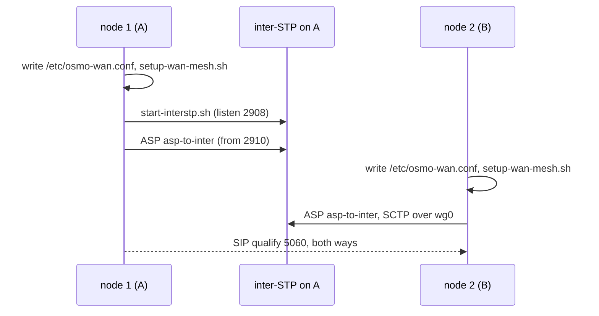

# WAN — linking two nodes

Two machines, each running its own stack (`start-native.sh`, one operator per
node), linked so that the mobile on node 1 can call and text the mobile on node
2. The method works the same on a LAN and over the Internet. Over the Internet
it goes through a **WireGuard** tunnel (§2), which is the only part that changes.

## 1. What crosses between the nodes

| Flow | Protocol / port | Who listens | Used for |
|---|---|---|---|
| SS7 (M3UA) | **SCTP 2908** | the inter-STP (the hub), one for the whole WAN | SS7 interconnect, point codes `1.<node><op>.<role>` |
| Voice signalling | UDP/TCP **5060** (single-operator node); 5080, 5082… (N-operator node) | Asterisk | PJSIP trunks between nodes |
| Voice media | UDP **20000–20499** (op 1) | Asterisk | RTP |
| SMS | TCP **7890** (op 1; 789x for op x) | `sms-interop-relay.py` | SMS between nodes |

Numbering works like a country code. Node N has prefix `NN` (11, 22…), and a
mobile's MSISDN is `<node>00<op><ms>`. The first mobile of node 2 is therefore
`20011`. From node 1 you reach it by dialling `22` + `20011` = **`2220011`**.
The sending node strips the prefix before going out on the WAN.

## 2. Why a tunnel over the Internet

Two nodes on the same LAN (or on the VirtualBox host-only segment) reach each
other directly: skip to §4. Over the Internet, without a tunnel, four things
break:

1. **SCTP does not cross the NAT** of a consumer router. The SS7 link to the hub
   never comes up.
2. The address in the WAN table must be **both** reachable by the peer **and**
   held by a local interface. The node uses it to recognise itself
   (`wan_nodes_detect_self`), and the SCTP ASP binds to it (`local-ip`). A
   NATed public IP cannot be both.
3. Asterisk's SDP announces `external_media_address` = the table address.
   Behind NAT, RTP goes to a private address.
4. Ports 2908/5060/789x/RTP would be exposed to the whole Internet.

With WireGuard, each node holds a private address that is **local and routable**
(`10.99.0.N`). SCTP travels inside the tunnel's UDP, and the WAN case becomes
the LAN case.

## 3. Step 1 — the WireGuard tunnel

Example plan:

| Node | Machine | Tunnel address | Extra role |
|---|---|---|---|
| 1 | A | `10.99.0.1` | runs the inter-STP (co-located hub) |
| 2 | B | `10.99.0.2` | — |

**At least one side must be reachable** on UDP 51820: public IP, or a port
forward on the router. Here, that is A.

On each machine:

```bash
sudo apt install wireguard
wg genkey | sudo tee /etc/wireguard/priv | wg pubkey | sudo tee /etc/wireguard/pub
sudo chmod 600 /etc/wireguard/priv
```

`/etc/wireguard/wg0.conf` on **A**:

```ini
[Interface]
Address    = 10.99.0.1/24
ListenPort = 51820
PrivateKey = <contents of /etc/wireguard/priv on A>

[Peer]                       # node 2
PublicKey  = <pub of B>
AllowedIPs = 10.99.0.2/32
```

`/etc/wireguard/wg0.conf` on **B**:

```ini
[Interface]
Address    = 10.99.0.2/24
PrivateKey = <contents of /etc/wireguard/priv on B>

[Peer]                       # node 1 (+ hub)
PublicKey  = <pub of A>
Endpoint   = <public IP or DNS name of A>:51820
AllowedIPs = 10.99.0.1/32
PersistentKeepalive = 25     # keeps the NAT mapping open on B's side
```

```bash
sudo systemctl enable --now wg-quick@wg0
```

> **Do not use a `192.168.x` range** for the tunnel. With no WAN table yet,
> `wan_detect_local_ip` prefers the first `192.168.*` address, which is the LAN
> one. With `10.99.0.0/24` there is no ambiguity. The command in §5 also gives
> the addresses explicitly.

## 4. Step 2 — check the link and open the firewall

```bash
ping -c3 10.99.0.2          # from A
ping -c3 10.99.0.1          # from B
sudo wg show                # a recent "latest handshake" on both sides
```

**Firewall.** `setup-wan-mesh.sh` calls `network/firewall-wan.sh`, which opens
**neither SCTP 2908** (the hub) **nor 5060** (direct SIP to a single-operator
node: only 5080 and up are opened). With an `INPUT` policy of ACCEPT (the
iptables default) this has no effect. With `ufw` active, SS7 and voice are
dropped. On the tunnel, the simplest fix is to trust the interface, on **both**
machines:

```bash
# ufw
sudo ufw allow in on wg0 from 10.99.0.0/24
# or iptables
sudo iptables -C INPUT -i wg0 -s 10.99.0.0/24 -j ACCEPT 2>/dev/null \
  || sudo iptables -I INPUT -i wg0 -s 10.99.0.0/24 -j ACCEPT
```

On a LAN without a tunnel, open the ports by hand, from the peer's IP: SCTP
2908 on the hub, then UDP/TCP 5060, UDP 20000–20499 and TCP 7890 on every node.

## 5. Step 3 — start the nodes (node 1 first)

Both nodes get the same table. Each one gets its own number, and all of them
point at the same hub. This is the scriptable form, with no questions and no
detection, and it is better than node cards for a first setup (see §7).

**A — node 1, runs the hub**:

```bash
sudo ./start-native.sh --regen-conf \
     --wan-nodes "1:10.99.0.1:11 2:10.99.0.2:22" --wan-id 1 --node 1 \
     --hub-ip 10.99.0.1 --interstp
```

**B — node 2**, once A shows `Inter-STP … OK`:

```bash
sudo ./start-native.sh --regen-conf \
     --wan-nodes "1:10.99.0.1:11 2:10.99.0.2:22" --wan-id 2 --node 2 \
     --hub-ip 10.99.0.1 --no-interstp
```

- `--wan-nodes` applies the WAN **for this run only**: the next plain
  `./start-native.sh` starts without it. Pass the same options again (or set
  `WAN_AUTO=1` in `/etc/osmo-wan.conf`) for the node to mesh at every start.
- `--regen-conf` starts from an empty table. The old one is saved as
  `/etc/osmo-wan.conf.avant-regen-<date>`. Without this option, a peer seen
  once and then switched off stays in the table and leaves a **PROHIB** route
  at the STP. On the very first start the option is not needed, but it is
  harmless.
- The hub is **co-located** on node 1's address (`--hub-ip 10.99.0.1`).
  `set_stp_ip.sh` supports this: node 1's ASP leaves from port 2910 towards the
  neighbouring hub on 2908. There is no extra address to add and no
  `AllowedIPs` to widen.
- Order matters. If B starts before the hub, its ASP waits and
  `start-native.sh` prints `hub 10.99.0.1 muet` (hub silent). Restart B once
  the hub is up.

What each start does, in order: write `/etc/osmo-wan.conf` →
`setup-wan-mesh.sh` (PJSIP trunks, `[wan_out]`/`[wan_in]` dialplan, SMS routes,
REDIRECT, firewall) → inter-STP (A only) → `set_stp_ip.sh` (point codes, ASP
`asp-to-inter` → `10.99.0.1:2908`) → start the stack.



## 6. Step 4 — check, layer by layer

| Layer | Command | Expected |
|---|---|---|
| Tunnel | `sudo wg show` | handshake less than 2 min old |
| SS7, from the hub (A) | `sudo checks/diag-interstp.sh` | both ASs `AS_ACTIVE`, no PROHIB/UNAVAIL route, no flapping |
| SS7, from a node | `sudo checks/ss7_check.sh` | `asp-to-inter` ACTIVE towards `10.99.0.1:2908` |
| SIP | `sudo asterisk -rx 'pjsip show endpoints'` | trunk to the peer `Avail` (qualify OK) |
| SMS | `cat /etc/osmocom/sms-routing.conf` | an entry for the remote node → `10.99.0.x:7890` |
| End to end | from mobile 1 on node 1, call `2220011`, then send an SMS to the same number | it rings and the SMS arrives on node 2; same the other way with `1110011` |

Useful capture: `tcpdump -ni wg0 sctp or port 5060 or port 7890`. The bench's
tcpdump wrapper also captures GSMTAP and M3UA.

Each step's logs are in `$LOG_DIR` (default `/tmp`): `wan-mesh.log`,
`interstp.log`, `set-stp-ip.log`.

## 7. Variants

**Node cards (`--gen-conf` / `--wan CARD`).** Each node writes its card, the
cards are exchanged, and each node imports the other's:

```bash
sudo ./start-native.sh --gen-conf mynode2.conf      # on B
sudo ./start-native.sh --wan mynode2.conf --node 1 --hub-ip 10.99.0.1   # on A
```

Before sending a card, check its `OSMO_NODE_IP` line. On a machine with no
table yet, the detected address is the LAN one (`192.168.x`), not the tunnel's.
Either fix the card by hand, or generate it **after** a first start with
`--wan-nodes`: the table is authoritative once its address is up.

**Same LAN, no tunnel.** Same command with the LAN addresses
(`--wan-nodes "1:192.168.1.10:11 2:192.168.1.20:22"`). `--hub-ip` is either
node 1's address (co-located) or a free address in the /24, which
`start-interstp.sh` will add.

**More than two nodes.** Add one entry per node to `--wan-nodes` (up to 9,
prefixes 11 to 99), and one WireGuard `[Peer]` per node on A. With the hub on
A, a star around A is enough for SS7. Voice and SMS go node to node, so every
node must reach every other: either a full WireGuard mesh, or
`AllowedIPs = 10.99.0.0/24` on the satellites with `net.ipv4.ip_forward=1` on A.

## 8. Common failures

| Symptom | Cause | Fix |
|---|---|---|
| PROHIB route at the STP towards a node that is off | old entry in `/etc/osmo-wan.conf` | restart with `--regen-conf` **on the node that runs the hub**: a hub already running elsewhere is not rebuilt |
| `aucune IP locale dans la table - passez --wan-id N` (no local IP in the table) | the table address is not on any interface (public IP, tunnel down) | `--wan-id N --node N`, check `wg show` |
| `… repond au ping mais pas en SCTP 2908` (answers ping but not SCTP 2908) | the hub is not running on the machine that holds the address | start A first, or `sudo ./launch/start-interstp.sh --ip 10.99.0.1` on A |
| ASP going up and down (flapping in `diag-interstp.sh`) | firewall on 2908, or two hubs | §4; only one node with `--interstp`, the others `--no-interstp` |
| SIP trunk `Unavail` | 5060 filtered (ufw), or wrong port targeted | §4; `pjsip show endpoints`, `tcpdump -ni wg0 port 5060` |
| The call rings but there is no audio | RTP filtered, or SDP with an address the peer cannot reach | open 20000–20499; the table address must be the tunnel's |
| SMS lost between nodes | TCP 7890 filtered, or no route | `sms-routing.conf`, `nc -zv 10.99.0.2 7890` |
